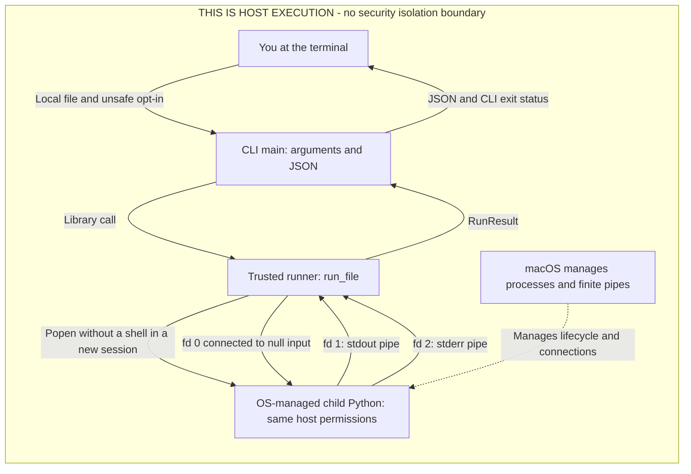
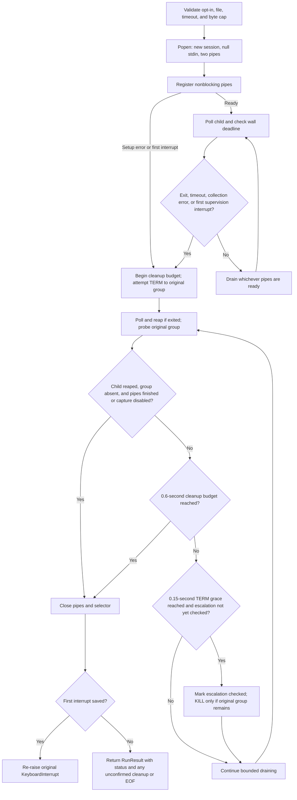
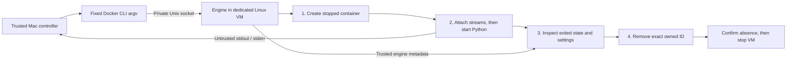
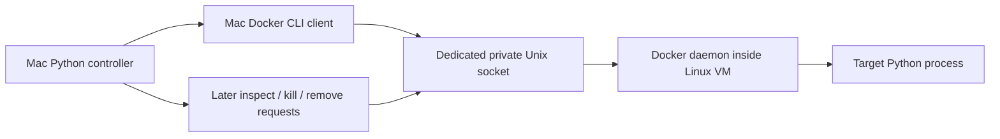
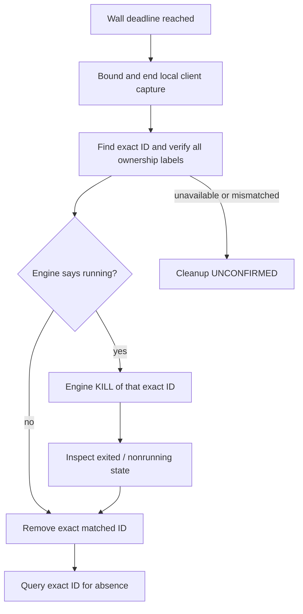

# Milestone 1: what happens between a command and a result?

This first chapter follows the original, no-CPU-option path. Milestone 2 is
appended below: it adds an explicitly experimental CPU **soft threshold**, not a
non-bypassable CPU cap. The original walkthrough and default behavior remain.

You type a PyBox command. A moment later, a structured result appears. **What
actually happened in between?** We will start with a print, build the small Python
and operating-system ideas it depends on, and follow them into the real runner.
You don't need to know process management already. Read one section, run its small
example, and explain the observation in your own words before moving on.
The `sh` fences provide complete terminal commands. The shorter `python` fences
quote real source to read alongside them; incomplete excerpts aren't additional
programs to run on their own.

This milestone implements a local Python runner and command-line interface
(CLI), not a sandbox. **The submitted file runs on your Mac with your host
permissions.** Only use your own short, controlled programs. A separate process,
a timeout, and Python's isolated mode do not prevent filesystem or network access.
There is no web server, UI, or AI layer here.

## What is doing the work when you run Python?

Your CPU, the hardware that executes machine instructions, doesn't directly
understand a line such as `print("hello")`. The **Python interpreter** is the
program that understands Python source and carries out its operations. The CPU
executes the interpreter's machine instructions as it does that work. A `.py`
**script** supplies instructions to the interpreter; the script and interpreter
are different files with different jobs.

Many programs need CPU time, memory, and files at once. The **operating system**
(OS), macOS here, manages their access to those resources. Its **kernel** is the
core that schedules running processes, manages memory and open connections, and
enforces host permissions. Python doesn't invent these resources: its libraries
provide ways for a program to request OS operations.

When the interpreter is running, it is a **process**: a running program with an
OS-assigned process ID (PID), memory, and open connections. A program is the saved
instructions; a process is one running instance. Starting the same interpreter
twice gives two processes, even though both started from the same executable file.
In PyBox, one Python process runs our supervising library, and it asks the OS to
start another Python process for the submitted script.

All commands below start in the repository root:

```sh
cd /path/to/pybox
python --version
```

The terminal's **shell** reads these commands. `cd` sets its current directory,
which is the starting point for relative paths such as `examples/hello.py`.
`python --version` runs the interpreter and asks it to report its version.
This Mac's verified working command is `python`, Python 3.11.3. Its `python3`
executable currently fails with `Bad CPU type in executable`; no repair or install
is needed for this tutorial. `-B` tells Python not to write `.pyc` cache files,
saved compiled forms of imported Python source. It doesn't forbid other file writes.

## First observation: text and success are different things

[examples/hello.py](examples/hello.py) contains exactly this:

```python
import sys

print("Hello from the child")
print("stderr is separate", file=sys.stderr)
```

`import sys` makes Python's `sys` module available under the name `sys`. A **module**
groups related Python functionality; the **standard library** is the collection
supplied with Python. `sys` gives access to interpreter information and its
standard input/output connections. PyBox, by contrast, is our own package in this
repository, not part of that standard library. A package groups modules; here
they live in the `pybox` directory. The dot in `sys.stderr` selects the name
`stderr` provided by the `sys` module.

`print(...)` calls a built-in function. The quoted value is a **string** (`str`),
Python's representation of text. Without another destination, `print` writes it
to **standard output**, or stdout, and adds a newline. `file=sys.stderr` is a
**named argument**: it says which function setting to change. It sends the second
print to **standard error**, or stderr, a separate connection often used for
diagnostics. Calling it “error” doesn't automatically mark the process as failed.

`python -m pybox` asks the interpreter to find our package and run its
[__main__.py](pybox/__main__.py) entry file. The `run`, path, and `--unsafe-local`
parts are arguments that this entry file parses using the standard-library
`argparse` module. The flag acknowledges unsafe host execution; it enables no
security boundary. This is a CLI: a command-line interface to the library.

The end of that entry file contains this real, non-standalone excerpt:

```python
if __name__ == "__main__":
    sys.exit(main())
```

Python sets the special name `__name__` to `"__main__"` for the entry module.
The `if` checks that value before calling `main`, the function defined earlier
in the file. A function is a named block of work; parentheses call it.
`main()` returns a number, and `sys.exit(...)` uses that number as the parent
CLI process's exit status. Merely naming a function `main` wouldn't run it.
Importing this module for tests also shouldn't run the CLI automatically, which
is why this check is useful.

Before running it, predict this: does writing to `stderr` make the program fail?
The shell's `echo` below prints `$?`, the exit status of the preceding command.

```sh
python -B -m pybox run examples/hello.py --unsafe-local
echo "CLI status: $?"
```

The CLI prints **JSON**, a text format for structured data with named fields.
This example contains all eleven fields of [RunResult](pybox/runner.py), the
runner's result object. The PID and elapsed time below are **illustrative**,
because they change on every run. The other values show the verified clean result
for this example:

```json
{
  "pid": 43210,
  "returncode": 0,
  "elapsed_s": 0.02,
  "stdout": "Hello from the child\n",
  "stderr": "stderr is separate\n",
  "timed_out": false,
  "stdout_truncated": false,
  "stderr_truncated": false,
  "output_complete": true,
  "group_cleanup_confirmed": true,
  "runner_error": null
}
```

You should see `CLI status: 0`. Neither output channel decides whether the program
succeeded. This file reaches its end normally, so its **exit status** is zero even
though it wrote to stderr. A program
can also exit unsuccessfully without writing any text.

Notice another separation: the CLI prints JSON on its own stdout. The child's
stderr is captured *inside that JSON*, rather than printed directly on the CLI's
stderr. [main](pybox/__main__.py) converts the returned object to JSON and then
chooses the CLI's exit status. It doesn't classify success by searching the text.
We will build the meaning of the remaining fields as we follow the child.

## Calling the library: a returned value isn't a print

### Name the settings instead of guessing their order

The CLI is only one caller. Our own Python program can import `run_file`, the
function exported by [pybox/__init__.py](pybox/__init__.py). Its real signature
(the function header, not a standalone program) is:

```python
def run_file(
    path: Union[str, os.PathLike],
    *,
    unsafe_local: bool = False,
    timeout_s: float = 2.0,
    max_output_bytes: int = 65536,
) -> RunResult:
```

The first argument, `path`, can be supplied by position. After `*`, settings are
**keyword-only**: write `timeout_s=2.0`, not an unexplained second positional
number. Values after `=` are defaults used when the caller omits a setting.
Unsafe opt-in defaults to `False`, so leaving it out refuses execution.

The words after `:` and `->` are **type annotations**, descriptions for readers
and tools, not automatic runtime checks. `str` means text, `int` an integer,
`float` a floating-point number, and `bool` either `True` or `False`.
`Union[str, os.PathLike]` describes either text or a filesystem-path object;
`-> RunResult` describes the returned object. The function's actual `if` checks
enforce the rules. In particular, `unsafe_local is True` requires the actual
boolean `True`; a truthy `1` or `"yes"` isn't sufficient. The CLI flag supplies it.

PyBox's runner is the **parent** that starts and supervises a **child** interpreter.
In this example, `os`, `json`, and `dataclasses` are standard-library modules;
`pybox` is our package. `from ... import ...` makes a particular name available
so we can call it directly. In the command below, `-` tells Python to read a program
from standard input. The shell's `<<'PY'` supplies the literal lines through the
closing `PY`, so we can run a short example without adding a repository file.
Run this from the repository root:

```sh
python -B - <<'PY'
import os
import json
from dataclasses import asdict
from pybox import run_file

print("parent PID:", os.getpid())
result = run_file(
    "examples/hello.py",
    unsafe_local=True,
    timeout_s=2.0,
    max_output_bytes=65536,
)
print("child PID:", result.pid)
print("child status:", result.returncode)
print("captured stdout:", repr(result.stdout))
print("result object:", type(result).__name__)
record = asdict(result)
print("Python values:", record["timed_out"], record["runner_error"])
print("JSON values:", json.dumps({
    "timed_out": record["timed_out"],
    "runner_error": record["runner_error"],
}))
PY
```

`result = run_file(...)` calls the function, waits for its supervision to finish,
and assigns its **return value** to a name. `return` gives a value to the caller;
`print` writes text to an output connection. They are different operations.
The child's greeting doesn't appear on the terminal just because `run_file`
returned: our own prints choose to display the captured text. `repr` shows a
string's representation, including `\n` for its newline instead of a line break.

`os.getpid()` asks the OS for this Python process's PID, whereas `result.pid`
records the newly created child's PID. The two differ. The OS gives each process
its own **address space**, the memory locations it can normally address. The child's ordinary Python variables
aren't the parent's variables; assigning one doesn't assign the other. The parent
builds `result` from observations it collected, not by reaching into the child's
Python objects. Separate memory helps keep a normal child exception from becoming
an exception inside the runner. **Both processes still use the same host
permissions, filesystem, and network; private memory isn't security isolation.**

### Turn the returned record into JSON

An **object** is a Python value with data and available operations; its **class**
describes what kind of object it is. The line `result object: RunResult` names the
class of the returned object:
`type(result)` obtains its class, and `.__name__` obtains that class's name.
`result.stdout` accesses a named **attribute** of it. `RunResult` is a **dataclass**:
Python generates the code for constructing a record from its declared field
values instead of us writing that setup by hand. Calling `RunResult` with those
named values creates an object holding them. Its source begins with this excerpt:

```python
@dataclass(frozen=True)
class RunResult:
    pid: int
    returncode: Optional[int]
    elapsed_s: float
    stdout: str
```

The `@dataclass(...)` line is **decorator** syntax: it asks Python to apply that
behavior to the class underneath it.
`frozen=True` prevents normal reassignment of its fields, so callers treat a
completed result as a record, not changing supervision state. It does not validate
types. `Union` and `Optional` come from the standard-library `typing` module.
`Optional[int]` means an integer or `None`; `None` is Python's value for
“no value here,” used when a status hasn't been confirmed.

`asdict(result)` creates a **dictionary**, a mapping from field names to values.
Thus `record["timed_out"]` looks up a value by its key instead of by an attribute.
`json.dumps(...)` then returns JSON text; it doesn't print by itself. Expect
`Python values: False None`, followed by
`JSON values: {"timed_out": false, "runner_error": null}`. Python's `False`/`True`
and `None` become JSON's `false`/`true` and `null`. The actual CLI uses the same
conversion in `print(json.dumps(asdict(result), indent=2))`; `indent=2` just makes
the text easier to read.

Here is the entire implemented architecture. The enclosing box is the host, not
a security barrier; “trusted” means we control the supervising code, not that it
can contain arbitrary submitted code. `Popen` is Python's child-launch interface.
The output arrows are **pipes**, OS connections carrying the child's output back
to the parent. The labels **fd** 0, 1, and 2 name OS connections for input, stdout,
and stderr; we will examine those descriptor numbers below. Read the return arrow
separately: the child doesn't construct `RunResult`; the supervising parent does.



## How does the parent create that child?

### Refuse a bad request before creating anything

Follow [run_file](pybox/runner.py). Before launch it requires `unsafe_local is True`,
a finite timeout greater than zero and at most 60 seconds, a per-stream byte cap
from 1 to 1,048,576, and an existing readable regular file. These checks catch bad
requests. They neither inspect the program for safety nor eliminate file-change
races between checking a path and opening it.

An invalid request **raises an exception** instead of returning a result: normal
execution stops and Python looks for a matching handler. You can observe the
opt-in check without starting any child:

```sh
python -B - <<'PY'
from pybox import run_file

try:
    run_file("examples/hello.py")
except PermissionError as error:
    print(type(error).__name__)
    print(str(error))
PY
```

`try` marks work that may fail; `except PermissionError` handles that particular
exception, and `as error` names the caught object so we can inspect it. Expect
`PermissionError` and the unsafe-local refusal message. Because the actual check
comes before `Popen`, nothing was launched. A type annotation alone wouldn't
provide this behavior. Likewise, the runner explicitly rejects booleans for the
numeric limits: Python treats booleans as a kind of integer, but `True` is not a
meaningful byte cap or timeout request.

### Name the interpreter and file

Next we need an interpreter and a file to give it. This small part of the real
launch preparation is safe to inspect on its own:

```sh
python -B - <<'PY'
import sys
from pathlib import Path

source = Path("examples/hello.py").resolve(strict=True)
print("interpreter:", sys.executable)
print("source:", str(source))
print("working directory:", str(source.parent))
PY
```

`sys.executable` is the interpreter executable running this process, verified here
as `/usr/local/bin/python`. `Path(...)` creates a Python object for a filesystem
path, with operations attached to it. An attached function is a **method**.
`.resolve(strict=True)` turns the relative
path into a resolved absolute path and requires it to exist. `.parent` selects
the containing directory. `str(source)` converts the object to text for the
argument list. None of these operations restricts what files the child may open.

The parent cannot create an independently supervised child merely by calling a
Python function in its own process. It needs the OS to create a process. The
standard-library `subprocess.Popen` requests that and returns a Python **handle**:
an object through which we inspect and manage the OS child. The name `process` in
our source refers to that handle, not to the OS process itself. A Python variable
and a running child have separate lifetimes; forgetting the variable wouldn't be
an instruction to terminate the child.

### Combine the OS request

Read the launch settings as three decisions. The ordered list beginning with
`sys.executable` gives the executable and its arguments; it isn't a shell command
string. `shell=False` avoids another program interpreting wildcards, redirections,
or command substitutions. The input/output settings connect null input and two
pipes, which we will inspect next. The working directory and environment choose
the child's starting configuration. `start_new_session=True` gives it a separate
session/process group for signaling, explained in the stopping section.

This is the actual combined launch call inside `run_file`, not a standalone
snippet. `subprocess` is the imported standard-library module:

```python
process = subprocess.Popen(
    [sys.executable, "-I", "-B", "-u", str(source)],
    shell=False,
    stdin=subprocess.DEVNULL,
    stdout=subprocess.PIPE,
    stderr=subprocess.PIPE,
    bufsize=0,
    close_fds=True,
    cwd=str(source.parent),
    env={"PATH": os.defpath, "LANG": "C", "LC_ALL": "C"},
    start_new_session=True,
)
```

`Popen` returns after creating the child, not after the whole script finishes.
Its later `poll()` calls ask the OS about completion. `bufsize=0` avoids an extra
Python buffering layer on the parent's binary pipe objects, while `close_fds=True`
avoids inheriting unrelated open connections. Avoiding a shell-parsing layer
doesn't remove the danger of the Python script itself. We don't need to guess
which low-level spawn syscall Python uses on this Mac.

The three child flags change Python's behavior, not its OS permissions. `-I`
ignores Python environment configuration, excludes user site packages, and leaves
the script directory off the import search path. Thus an `import helper` from a
neighboring `helper.py` may fail; interpreter-level installed packages can still
be available. `-B` disables import-generated bytecode writes, not all file writes.
`-u` makes the child's stdout and stderr unbuffered so Python doesn't hold prints
in its own temporary output storage. That is a different layer from the parent's
`bufsize` setting; the OS pipes still buffer bytes.

The **environment** is a mapping of names to text values supplied to a process,
often used for configuration. The explicit `env` dictionary replaces automatic
inheritance of the host's environment. Its PATH tells programs where to search
for commands; LANG and LC_ALL set **locale** configuration, conventions for things
such as language and number formatting. It supplies those minimal
settings rather than copying environment credentials. Commands outside that PATH
may not be found.
This is useful configuration hygiene, **not protection against reading secrets
from host files**. The child works in the script's directory; that directory is
neither disposable nor restricted. Even a temporary directory used in a lesson
is not a sandbox.

## Where does a print go, and why must we read two pipes?

An OS **file descriptor** is a small integer naming an open connection in one
process. By convention, descriptor 0 is standard input, 1 is stdout, and 2 is
stderr. Those numbers don't identify three universal files; each process has
its own descriptor table, and the connections can be redirected.

For this child, fd 0 reads from the null device, so `sys.stdin.read()` returns the
empty string rather than waiting for you to type. Fd 1 and fd 2 write to separate
**pipes**: OS-managed byte buffers connecting the child's writes to the parent's
reads. The parent names its read connections `process.stdout` and `process.stderr`.
The parent's descriptor numbers need not be 1 and 2.

### Text is interpreted; a pipe carries bytes

A **byte** is an eight-bit value. Pipes transfer sequences of bytes, not Python
strings or dictionaries. An **encoding** chooses how text characters become
bytes; a **decoding** interprets bytes as text again. PyBox decodes captured output
using UTF-8. One character can occupy several bytes, so a byte cap and a character
cap are different. Try the same operations the capture code relies on:

```sh
python -B - <<'PY'
text = "€!"
data = text.encode("utf-8")
retained = bytearray()
retained.extend(data[:2])
print("characters and bytes:", len(text), len(data))
print("byte values:", list(data))
print("decoded retained bytes:", retained.decode("utf-8", errors="replace"))
PY
```

Expect `characters and bytes: 2 4`, byte values `[226, 130, 172, 33]`, and the
replacement character `�` for the retained text. `encode` produced a `bytes`
object, an **immutable** sequence: its existing byte values can't be changed in
place. `bytearray` is **mutable**, so `.extend(...)` can append received bytes
without constructing a new string
for every read. `len` counts elements: text characters for this `str`, byte
values for `bytes`. `data[:2]` is a **slice**, selecting the first two bytes.
Those are only part of the euro character's three-byte UTF-8 encoding.
`errors="replace"` substitutes a visible replacement instead of raising a decode
error. This is why truncated captured text may end with that character.

### The reader must keep making space

A pipe has finite capacity. If the child writes faster than the parent reads,
eventually a write waits for space. That is **backpressure**: the receiving side's
pace constrains the sender. Imagine a parent reading stdout until end-of-file
while ignoring stderr. The child fills stderr and blocks before it can exit;
the parent waits for stdout to close, which needs the child to finish. Each waits
for the other. More memory for the captured string would not fix that ordering.

Python's standard-library **selector** asks the OS which registered connections
are ready. The OS supplies that readiness information; Python supplies the API
for requesting it. “Readable” means a read can obtain data or detect **end-of-file
(EOF)**, the indication that no more bytes can arrive, without waiting for a
future write; it doesn't mean the whole program is finished.
The runner prepares the pipes with this real excerpt:

```python
for name, pipe in (("stdout", process.stdout), ("stderr", process.stderr)):
    os.set_blocking(pipe.fileno(), False)
    selector.register(pipe, selectors.EVENT_READ, name)
```

The `for` visits each pair and assigns its two values to `name` and `pipe`.
`.fileno()` obtains the OS descriptor number from the Python pipe object.
`os.set_blocking(..., False)` asks the OS not to make an individual read wait for
future data. `register` watches this connection for reading and attaches its
stream name; otherwise a later readiness event wouldn't tell our capture code
which output buffer to use.

The helper `drain_once(wait_s)` is a **nested function**, defined inside `run_file`.
It can read names available in that particular `run_file` call, such as `selector`
and `max_output_bytes`, and update the surrounding captured objects. The real
initialization is:

```python
captured = {"stdout": bytearray(), "stderr": bytearray()}
truncated = {"stdout": False, "stderr": False}
eof = set()
errors = []
```

Each dictionary key names one stream. Its value is either that stream's byte
buffer or its truncation flag; `captured["stdout"]` looks up one buffer, not all
output. A set stores distinct items, here the names that reached EOF, so seeing
both names confirms both ends finished. The list `errors` collects problem
messages. These are Python bookkeeping objects in the parent, not OS objects in
the child. Each `run_file` call creates its own bookkeeping.

The helper services whichever pipes are ready in one loop. This is concurrent
draining, not two reader **threads** (independent execution paths inside a
process), and not a promise of reading both streams at the same instant.

These are real excerpts from `drain_once`; omitted branches handle readiness
races and end-of-file:

```python
for key, _ in selector.select(wait_s):
    try:
        data = os.read(key.fd, 8192)
    except (BlockingIOError, InterruptedError):
        continue
```

```python
retained = captured[key.data]
remaining = max_output_bytes - len(retained)
retained.extend(data[:remaining])
if len(data) > remaining:
    truncated[key.data] = True
```

`selector.select(wait_s)` waits up to that many seconds for readiness, then
returns pairs. `key` holds connection information; `_` is our name for the
unused readiness flags, not special Python syntax. `os.read(key.fd, 8192)` asks
the OS for at most 8,192 bytes. Readiness can change before the read, so
`BlockingIOError` means “not ready now,” and `InterruptedError` allows a later
retry after an interrupted read. Nonblocking mode keeps that race from turning
into an indefinite wait. The two exception names in parentheses mean catch
either kind. On an empty read, the helper records EOF, removes that pipe from
the selector, and closes it; without removing it, the loop could keep watching
a connection that has nothing left to deliver.

`key.data` is the stream name attached during registration. `retained` names the
same bytearray stored under that dictionary key; `.extend` changes it in place,
so the surrounding `run_file` sees the change without the helper returning a new
buffer. These are shared references within the parent, not shared Python objects
across the two processes. `remaining` subtracts the bytes already retained from
the cap. `data[:remaining]` selects only what fits for `.extend` to append;
with zero remaining, it selects no bytes. The `if` records whether any
bytes were discarded. The first excerpt continues reading later bytes.
**A capture cap limits what we keep, not how much the program can write.**
Stopping reads at the cap would bring back the same full-pipe problem. This cap
bounds retained output per stream before UTF-8 decoding; it doesn't limit the
child's memory or CPU use.
Nor do two separately captured strings establish a total ordering between their
prints: the result preserves each stream's content, not a merged event timeline.

## Observe the difference between keeping and draining

Predict the result of this finite burst: can output be truncated *and* completely
drained? This experiment creates `pipes.py` in a temporary directory, prints its
absolute path, and removes that directory afterward. It requests 65,536 bytes of
writes to each stream, not an unbounded flood.

`with TemporaryDirectory(...) as directory` is a **context manager**. It creates
the temporary directory on entry and removes it on exit, including when the body
raises an ordinary exception. That gives this lesson's files a defined lifetime;
it doesn't make executing them safe. `Path.write_text(..., encoding="utf-8")`
writes our controlled source into that directory. The parent then asks `run_file`
to execute the named file with an explicit two-second deadline.

```sh
python -B - <<'PY'
from pathlib import Path
from tempfile import TemporaryDirectory
from pybox import run_file

with TemporaryDirectory(prefix="pybox-pipes-") as directory:
    path = Path(directory).resolve() / "pipes.py"
    path.write_text(
        "import os\n"
        "for _ in range(16):\n"
        "    os.write(1, b'a' * 4096)\n"
        "    os.write(2, b'b' * 4096)\n",
        encoding="utf-8",
    )
    print("temporary program:", path)
    result = run_file(path, unsafe_local=True, timeout_s=2.0, max_output_bytes=32)
    print("retained:", repr(result.stdout), repr(result.stderr))
    print("truncated:", result.stdout_truncated, result.stderr_truncated)
    print("EOF reached:", result.output_complete)
    print("status and runner error:", result.returncode, result.runner_error)
PY
```

In the generated program, `range(16)` gives the loop sixteen iterations.
The `b` prefix makes `b'a'` a byte literal; multiplying by 4,096 repeats it.
`os.write(1, ...)` and `os.write(2, ...)` write those bytes directly to the child's
stdout and stderr descriptors, bypassing Python's `print` formatting. The program
has a fixed small amount of work, not an exhaustion test. The adjacent quoted
strings passed to `write_text` form one string; `\n` inserts the source file's line
breaks, and the spaces before `os.write` indent its loop body.

Expect 32 `a` characters and 32 `b` characters, both truncation flags true,
`output_complete` true, status 0, and runner error `None`. EOF doesn't mean that
every byte was retained. These observations are compatible because the runner
discarded excess bytes while continuing to empty both pipes. The actual pipe
capacity is OS-dependent; this exercise doesn't
measure it or prove exactly when a write blocked.

## A sleeping program consumes time without doing much work

[examples/slow.py](examples/slow.py) prints a starting message, calls
`time.sleep(2)`, and prints `Sleep finished`. Sleeping makes the process wait;
it doesn't spend two seconds continuously executing Python instructions.

Try the same finite file with two different deadlines:

```sh
python -B -m pybox run examples/slow.py --unsafe-local --timeout 3
echo "CLI status: $?"
python -B -m pybox run examples/slow.py --unsafe-local --timeout 0.2
echo "CLI status: $?"
```

With three seconds, ordinarily both messages appear, child status is 0, and CLI
status is 0. With 0.2 seconds, expect `timed_out: true`, no `Sleep finished`,
normally child `returncode: -15`, and CLI status `124`. Startup can be delayed on
a loaded Mac, so even the starting message isn't guaranteed before the deadline.

Predict why the second run times out despite spending most of its life asleep.
**Wall time** is elapsed time while the process runs, sleeps, or waits for
input/output (I/O).
**CPU time** counts time actually spent executing on a CPU. The runner uses
`time.monotonic()` to track wall time; it isn't measuring CPU time. Monotonic time
doesn't jump when the calendar clock is corrected. This result contains no CPU
telemetry, so we must not turn the sleep observation into a measured CPU number.

`time.monotonic()` returns a number of seconds from an unspecified origin; the
difference between two readings is what matters, not their calendar date.
The real loop sets `deadline = started + timeout_s`. Its
`while process.poll() is None` means repeat while the OS hasn't supplied a child
status; `None` is different from successful status 0. It subtracts the current
clock reading from the deadline, then uses `min(POLL_INTERVAL_S, remaining)` to
avoid waiting longer than the next check. This is Python arithmetic organizing
OS-backed observations, not a kernel-enforced CPU limit.

`started` is recorded just before `Popen`, so startup is included. Cleanup comes
afterward and is also included in `elapsed_s`. A 0.2-second timeout is
**not a promise to return within exactly 0.2 seconds**: termination and final
draining take additional time, and process creation, scheduling, and kernel calls
aren't hard real-time guarantees.

## Stopping a process is a conversation with the OS

POSIX is a family of OS interfaces supported by Unix-like systems, including this
Mac. Here we use its process groups and signals. A **signal** is an OS notification
to a process, not a Python function call inside that process.
`start_new_session=True` creates a new POSIX **session**, an OS grouping of process
groups. The child initially leads a new **process group**, a set of processes that
can be signaled together. At launch its PID, session ID, and process-group ID are
equal. The parent remains outside that new group. Ordinary descendants inherit
the group, so `os.killpg(process.pid, signal.SIGTERM)` targets more than just the
direct child. A session is an organizational mechanism, not a containment wall.

**SIGTERM** requests termination. A program can install a handler or ignore it.
If the original group remains after the 0.15-second grace period, the runner
attempts **SIGKILL**, which the targeted program cannot catch or ignore. On this
POSIX system, `Popen` reports signal termination as a negative signal number:
`-15` for SIGTERM and `-9` for SIGKILL. If the program handles TERM and exits with
its own status, the result records that status instead. Neither negative number
proves a CPU or memory limit was enforced.

Sending a signal doesn't collect an exit status. The parent must also **reap** its
direct child: ask the OS for its termination record so it can release that record.
Here `process.poll()` is a method on our Python handle, not the child doing a poll
of itself. It performs a nonblocking OS status check and reaps an exited
child, updating `process.returncode`. It can return `None` while the child is still
running. The group probe `os.killpg(process.pid, 0)` sends no terminating signal;
it checks whether the original group is still observable. Failure to confirm
absence is reported, not silently treated as success.

This is the implemented lifecycle. Polling can reap an already-exited child
*before* escalation; the diagram doesn't pretend every run needs SIGKILL:



Validation or launch failure raises before this post-launch path. A collection
failure disables capture but still leads to group cleanup; missing EOF then makes
`output_complete` false. The 0.6-second budget covers cleanup *and* final draining,
not 0.6 seconds added after the TERM grace. The loop can finish much sooner when
the child is reaped, the group is absent, and collection has finished.

Why attempt TERM even after a normal exit? Suppose the program starts an ordinary
same-group child, then exits with status 0. That descendant may still be running
and may have inherited stdout's write end. A pipe reaches EOF only after **all**
write ends close, not merely when the original writer exits. Cleanup therefore
targets the original group on normal exit too, even if descendants redirected
their output elsewhere. It preserves the direct child's status 0; it doesn't
invent a failure status just because descendants needed cleanup.

The same principle explains the finite drain budget. If EOF never arrives, waiting
forever would make a “finished” program hang PyBox. The runner closes its read
connections after bounded attempts and reports incomplete collection or cleanup.
This is best effort, not a promise to kill unkillable kernel activity or descendants
that created a different group or session.

Finally, `-15` in JSON and `124` from the shell answer different questions.
[main](pybox/__main__.py) returns 124 when `timed_out` is true, independently of
which child status termination produced. It returns 0 for clean code success,
1 for code failure, 2 for refused or invalid input, and 125 for runner problems.
Runner problems take precedence over timeout. For example, a child exiting with
`sys.exit(7)` retains JSON status 7, but the CLI maps code failure to status 1.

## The Ctrl-C bug: closing a connection doesn't stop its owner

Python's `try`/`except` machinery handles control flow when something raises.
A **finally** block runs as control leaves its `try`, whether the work succeeded
or raised an exception. That makes it a useful place to clean up owned resources.
It doesn't make the cleanup code itself immune to interruption, nor cause it to
terminate processes automatically. The runner must perform those operations.

Ctrl-C normally raises `KeyboardInterrupt` in the parent Python process. Because
the child has a separate session, the runner must not assume the terminal also
interrupted it. The parent remains responsible for termination and reaping.

The first review reproduced an interruption while the cleanup loop was draining
pipes after TERM. That child ignored TERM. The old path left cleanup early, closed
the pipes, and skipped KILL and reaping. Closing the parent's read connections
doesn't kill a sleeping child: a descriptor and a process are different OS objects.

Why didn't `except Exception` handle this? Python arranges exception types in
a family tree. A handler for a parent type catches types beneath that branch.
`BaseException` is the root; ordinary errors such as `PermissionError` belong to
its `Exception` branch, but `KeyboardInterrupt` belongs outside that branch.
Thus `except Exception` missed the interrupt. The correction explicitly saves it,
continues best-effort cleanup using the existing deadlines, closes resources,
and only then re-raises that same interrupt. A real excerpt from the protected
cleanup loop is:

```python
except KeyboardInterrupt as exc:
    if interruption is not None:
        raise
    interruption = exc
```

`interruption` initially holds `None`. On the first interruption we store the
exception object and resume cleanup. The bare `raise` propagates a second
interruption rather than promising to recover from repeated cancellation. After
cleanup, the source uses `raise interruption` to raise the saved first object.
No `RunResult` is returned on that path: cancellation is postponed, not called
success. Keeping the original deadline matters too; repeatedly restarting a grace
period would make the advertised budget meaningless.

A second review moved the interruption one step earlier: initializing cleanup's
clock was outside the protected loop. Guarding only the pipe read still left a
way to skip termination. The current structure protects cleanup as a phase,
including entry and descriptor closure, and also guards post-launch pipe setup.
Inside that protected phase, this real excerpt establishes the cleanup origin
only if one hasn't been stored:

```python
if cleanup_started is None:
    cleanup_started = time.monotonic()
kill_at = cleanup_started + TERM_GRACE_S
cleanup_deadline = cleanup_started + CLEANUP_GRACE_S
```

If the first clock call is interrupted before the origin is stored, recovery
tries to establish it. If it was already stored, recovery derives both deadlines
from that same value; it doesn't restart the budget. The finite regressions check
those particular interruption sites, not universal Ctrl-C safety. Repeated
interruptions remain unsupported, and no guarantee covers every possible Python
instruction boundary, OS scheduling delay, or kernel call. This recovery assumes
`Popen` has returned a child handle. Interruption during creation before that
handle is acquired, or abrupt parent death, is outside its coverage.

Use the finite regressions in [RunnerTests](tests/test_runner.py), rather than
trying to hit a timing window by repeatedly pressing Ctrl-C:

```sh
python -B -W error::ResourceWarning -m unittest discover -s tests -v
```

The tests generate controlled programs with three-second self-expiry and use a
five-second watchdog per test. Named cases cover TERM-ignore escalation,
normal-exit descendant cleanup with and without inherited pipes, byte caps, and
interruptions in the loop, at cleanup entry, after the clock was established, and
during post-launch pipe setup. The guarded interruption cases also have independent
final kill/reap/close protection if an assertion fails. These tests check specific
lifecycle behavior; they aren't evidence of sandbox security.

## Reconstruct the result without guessing

Now the execution story can be rebuilt as four steps:

1. The caller supplies settings, and the runner validates them before asking the
   OS to create a child. Python receives a handle to that child; it hasn't received
   the completed program's answer yet.
2. While the child is observed running, the parent drains its stdout and stderr
   connections and checks wall time. Bytes travel through pipes; they don't carry
   an authoritative “success” label.
3. The OS supplies the direct child's status when it exits, but the parent still
   attempts original-group cleanup and final draining. Descendants and inherited
   pipe writers explain why status collection and cleanup are separate jobs.
4. The parent closes its connections, then re-raises a saved interrupt or returns
   a result recording status, retained text, and what cleanup confirmed. Only the
   CLI caller converts that object to JSON and chooses its own exit status.

Keep the ownership of each mechanism clear when rereading the source:

| What the OS provides | How our Python code uses it, and why |
| --- | --- |
| Processes, PIDs, and address spaces | `Popen` requests a child and returns a handle; a function call inside the parent alone wouldn't create an independently managed process. |
| Descriptor tables and finite pipes | `PIPE`, `os.read`, and `os.write` connect and move output; dictionaries and `bytearray` objects only keep the parent's copy. |
| Readiness and nonblocking behavior | `selectors` and `os.set_blocking` let one loop service both pipes without waiting indefinitely on one empty stream. |
| A monotonic clock | `time.monotonic` lets our Python loop compare elapsed time without calendar-clock jumps; it supplies no CPU-time limit. |
| Exit records, groups, and signals | `poll` collects the direct child's status; `os.killpg` asks the OS to signal a group. Requesting termination and collecting the result are different operations. |

The milestone 1 result now has a reason for every field. This table uses Python type
names; JSON writes missing values as `null` rather than Python's `None`:

| Fields and types | What the runner actually observed |
| --- | --- |
| `pid: int`, `returncode: int or None` | The direct child's PID and collected status. Zero is normal success, positive values are exit codes, and negative values identify POSIX signals. None means reaping wasn't confirmed. |
| `elapsed_s: float`, `timed_out: bool` | Monotonic wall time including launch and cleanup; whether supervision reached its deadline while it still observed the child running. Neither is CPU telemetry. |
| `stdout: str`, `stderr: str` | Separately retained bytes decoded as UTF-8, with replacement for invalid or cut characters. |
| `stdout_truncated: bool`, `stderr_truncated: bool` | Whether bytes from that stream were discarded after its retention cap filled. |
| `output_complete: bool` | Whether both pipes reached EOF, even if retained output was truncated. |
| `group_cleanup_confirmed: bool` | Whether the direct child was reaped and its original process group was observed absent. It says nothing about escaped descendants. |
| `runner_error: str or None` | Post-launch collection or cleanup problems, separate from the program's own failure. None means no such problem was recorded, not that execution was secure. |

An ordinary Python traceback, the report of where the script raised an unhandled
exception, belongs to the child's stderr and usually accompanies child status 1.
It is not itself a `runner_error`. Refusal or invalid input instead raises before
launch. Problems caught during post-launch collection or cleanup are reported
through `runner_error`, rather than confused with the script's own traceback.

## What did we gain, and where does this stop?

We can now explain a result by following real objects: a file becomes a child
process; fd 1 and fd 2 feed finite pipes; the parent drains both, retains bounded
bytes, checks elapsed wall time, signals the original group, reaps its direct
child, and reports what it could confirm. Each result field has a concrete reason
to exist. The useful code to revisit is [run_file, RunResult, drain_once, and
signal_group](pybox/runner.py), together with [CLI main](pybox/__main__.py) and the
[finite examples](examples). [PROGRESS.md](docs/PROGRESS.md) records the milestone.

What we **cannot** explain away is host access. No filesystem or network isolation
exists, and this default path installs no CPU, memory, process-count (PID), or disk limits.
The output cap limits retained bytes, not those resources. Original-group cleanup
doesn't catch escaped descendants. Python `-I`, the minimal environment, and a
temporary working directory do not change that boundary. This backend remains
local-only and must never be a public execution backend or fallback.

A public web app and server-side OpenRouter integration are **future, unimplemented
work**, gated on real execution isolation, enforced resource controls, and
enforceable AI usage, abuse, and spending limits. Trusted application/AI code and
credentials must stay outside submitted-code execution. The OpenRouter key must
never enter the browser or child, or appear in outputs or logs. No key is needed
for this milestone.

The next useful question is: **how would we stop a program for consuming too much
CPU time, rather than simply existing too long?** Our sleeping example shows why
that is a different mechanism. Answering it would require an explicit, controlled
limit experiment and evidence of enforcement, not a guess from an exit code.
That was the stopping point for milestone 1. The next chapter records the small
experiment we subsequently authorized, including the result that changed its scope.

# Milestone 2: why can a sleeper outlive a CPU-second budget?

Imagine two children. One says “wake me in two seconds” and sleeps. The other
keeps doing arithmetic. A stopwatch on your desk advances for both. But the CPU
does almost no work for the sleeper while it is waiting. If we want to distinguish
these cases, our original wall deadline is the wrong measuring stick on its own.

We added `--cpu-soft-limit` for this experiment, while keeping `--timeout`.
**This is still unsafe host execution, and the new option is not a non-bypassable
CPU cap.** We first hoped to demonstrate a forced hard stop. Testing this Mac
showed that the hard *setting* and a forced hard *stop* were different things.
That observation narrowed this milestone to an educational soft-threshold
experiment. We did not hide the mismatch behind a successful setup call.

## Start with the observation, not the API name

From the repository root, run these separately, not in parallel:

```sh
python -B -m pybox run examples/slow.py --unsafe-local --cpu-soft-limit 1 --timeout 4
```

Predict first: does a two-second sleep necessarily spend two seconds on the CPU?
The expected result on this Mac is `Sleep finished`, child status 0, and
`timed_out: false`. Its `elapsed_s` is a little over two seconds even though the
configured CPU soft value is one. The command exits with CLI status 0.

Now compare it with our new finite example:

```sh
python -B -m pybox run examples/compute.py --unsafe-local --cpu-soft-limit 1 --timeout 4
```

We expect `Starting finite computation`, followed by `termination_signal:
"SIGXCPU"`, `returncode: -24` on this Mac, and `timed_out: false`. The CLI exits
1 because the submitted program ended by a signal; 124 remains reserved for the
parent's wall timeout. Signal numbers are platform-specific; prefer the name.
The computation doesn't need to reach its final print for this to be a useful
observation. The kernel stopped the interpreter before it reached that line.

On the 2026-10-15 validation run, the sleep took **2.037301 wall seconds**, exited
0, and printed both lines. The computation took **1.023556 wall seconds** and
ended by SIGXCPU. Both reported installation of `(1, 2)`, no wall timeout,
complete pipe draining, and confirmed original-group cleanup. These are the
observed results of those controlled programs, not inferred CPU-usage metrics.

These predictions aren't timing promises. If the Mac is busy, the child might
not receive enough CPU before the wall deadline. It may instead be terminated by
the parent, or reach its own finite stopping condition. Read both the signal and
the `timed_out` field instead of assuming every nonzero exit demonstrates a CPU
threshold. Neither command runs hostile code or starts descendants.

The complete [compute example](examples/compute.py) is deliberately bounded:

```python
import signal
import time

signal.alarm(5)
deadline = time.monotonic() + 4
print("Starting finite computation", flush=True)
value = 0
for _ in range(100_000_000):
    value = (value + 1) % 1000003
    if value % 10000 == 0 and time.monotonic() >= deadline:
        break
print("Computation finished without CPU-signal termination")
```

`range(100_000_000)` supplies a finite sequence of numbers; the underscores just
make the number readable. `for` repeats the indented body once per number. `_`
is an ordinary variable name that conventionally means “I won't use this value.”
`%` computes the remainder after division, keeping `value` small and making the
wall-clock check happen periodically. `break` leaves the loop. The kernel-backed
`signal.alarm(5)` also schedules a SIGALRM after five wall seconds if the process
is still alive; its default action terminates this program. These safeguards are
for our known experiment, not guarantees for code that changes its own handlers.
The runner's independent four-second deadline remains outside the child.

## The scheduler explains the two clocks

The kernel's **scheduler** chooses which runnable process gets a CPU core next.
“Runnable” means it can do work now. A sleeping process normally stops being
runnable until its wake-up time; a computing process stays eligible. Being
eligible is not a promise of immediate service: other processes compete for cores.

**Wall time** measures how much time has passed, whether a process was executing,
waiting, or asleep. Our parent measures it with `time.monotonic()`. **CPU time**
counts time the OS charges to a process for executing. It includes **user time**,
spent executing the program and interpreter, and **system time**, spent executing
kernel work on that process's behalf. It excludes time merely waiting to be
scheduled. Multiple threads within a process can consume CPU concurrently; we
use one computing thread here, not a parallel load.

This is why a wall deadline still matters. CPU accounting won't stop a program
that spends most of its life asleep or waiting for input. Conversely, a heavily
scheduled computer can take several wall seconds to deliver one CPU second to
our child. “One CPU second” doesn't mean “one second after pressing Enter.”

Python exposes several related functions, but they serve different purposes:

| Python request | What it gives us |
| --- | --- |
| `time.monotonic()` | A clock reading suitable for wall deadlines; subtract readings to measure elapsed wall time. |
| `time.process_time()` | CPU time for the current process, not elapsed sleep time or a sum over descendants. Useful for a controlled measurement, not used by this runner to supervise the child. |
| `resource.getrusage(resource.RUSAGE_SELF)` | A record of the calling process's resource usage; `.ru_utime` and `.ru_stime` are user and system CPU seconds. Used in the diagnostic probe, not returned as runner telemetry. |
| `resource.setrlimit(...)` | A request to the OS to change a resource-limit setting for the calling process. It is configuration, not a measurement. |

The distinction between reading and changing matters. If the parent called
`setrlimit`, it would limit **itself**, potentially interrupting its own supervision.
Only the trusted bootstrap in the child makes that request.

## Two numbers: a soft threshold and a hard setting

Python's `resource` module provides a standard-library interface to Unix resource
limits. `resource.RLIMIT_CPU` is a named constant selecting the CPU-time resource;
it isn't a number of seconds itself. The second argument supplies the numbers:

```python
resource.setrlimit(resource.RLIMIT_CPU, (soft, soft + 1))
```

This is a real line from [_cpu_bootstrap.py](pybox/_cpu_bootstrap.py), **not a
standalone instruction to run in your supervising Python process**. A **tuple**
such as `(1, 2)` is an ordered pair of values. Its first position is the soft value,
and its second is the hard value. Here `soft` is the validated whole-number input;
`soft + 1` leaves one additional CPU second between the configured values.

The **soft** value is the threshold at which the OS sends SIGXCPU. A signal is a
kernel-delivered notification with a default action. SIGXCPU's default action
terminates the process, which is the behavior our ordinary compute example shows.
But a program can register a handler or ignore it. A **handler** is a function
Python calls in response to that signal; our tests use a tiny handler that exits
with status 23. That result has no termination signal, even though the handler
ran because of SIGXCPU. Therefore “the process didn't die by SIGXCPU” doesn't
prove that no soft notification happened.

The **hard** value ordinarily restricts how far an unprivileged process may raise
its own soft value. Starting from `(1, 2)`, it can request `(2, 2)`. It cannot
raise the hard setting to 3 without the necessary privilege. Tests verify that
raising the soft value succeeds and raising the hard value is refused under this
user. “Immutable ceiling” here means a ceiling on changing the setting, not a
guarantee that this Mac will kill a process at that many CPU seconds. A privileged
process is outside that ordinary-user claim; do not run this runner as root.

Whole-number granularity is intentional. `cpu_soft_limit_s=1` requests one CPU
second; `0.2`, `1.0`, `True`, zero, and strings are rejected before spawn. Although
Python treats `bool` as a kind of integer in some operations, `True` would be a
confusing resource budget, so validation excludes it explicitly. `None` means
the caller omitted this feature; it does not mean the child has no inherited OS
limits. Supported inputs are 1 through 60. A larger CPU threshold than available
wall time may never be reached, and that is consistent with two independent clocks.

## A hard setting is not proof of a hard stop

On **this macOS 27.0.1 arm64 build with Python 3.11.3**, we ran one finite
computing process that ignored SIGXCPU. It read back `(1, 2)`, then measured
2.196681 user CPU seconds and 0.003571 system CPU seconds during its bounded work.
Total lifetime CPU, including startup, was 2.222256 seconds. It exited normally
with status 0 after 2.236249 wall seconds. The runner had not reached its wall
deadline and confirmed cleanup. The parent's resource setting was unchanged.

That probe had a finite iteration count, a 3.2-second self wall check, a five-second
child alarm, a four-second runner deadline, and a seven-second outer watchdog. We
did not keep it running to “see how far it could go.” Exceeding 2 CPU seconds was
enough to disprove a guaranteed forced stop at the configured hard value on this
build. The test suite repeats a similarly finite observation.

Some systems force SIGKILL at a CPU hard limit. At M2 we had not tested another
OS; the later M3c chapter below records the separate measured Linux comparison.
We do not substitute documented behavior for this machine's measured result.
Nor does one Mac build establish a claim about every macOS release. This is why
the option is called `--cpu-soft-limit`, with no hard-enforcement mode. A future
mode promising a non-bypassable cap would need a separately verified mechanism
and must refuse when that mechanism is unsupported. A parent CPU sampler, Linux
VM, and containers were deliberately not added to rescue the original assumption.

## Why start Python twice, but keep one child PID?

Our reusable library might be called from a program with multiple threads. Running
arbitrary Python via `Popen(preexec_fn=...)` between fork and exec can deadlock:
after a fork, only the calling thread survives in the child, while copied lock
state might still say a vanished thread owns a lock. The standard library warns
against using that hook in a threaded application. We avoid it entirely.

Instead, the optional path starts a fresh interpreter running our trusted
bootstrap file. It imports `resource`, installs the tuple, and checks that the OS
reads back exactly what it requested. Only then does it execute this line:

```python
os.execv(sys.executable, [sys.executable, "-I", "-B", "-u", sys.argv[3]])
```

`sys.executable` names the Python executable already in use. The list supplies
its command-line arguments without invoking a shell. `sys.argv[3]` is the target's
absolute path passed privately to the bootstrap. **exec** asks the OS to replace
the current process's program image. It does not create a new PID or another
child. On success this function never returns: the old Python interpreter and
its variables have been replaced by the new interpreter running the target.
The PID, process group, resource limits, and accumulated CPU accounting survive.
The extra startup adds overhead, and it counts toward the budget too.

This replacement avoids reproducing Python's script behavior ourselves with
`runpy` or `exec(source)`. The target sees the same `sys.argv`, `sys.orig_argv`,
`__file__`, `__name__`, import path, current directory, flags, traceback, and
`SystemExit` behavior as a direct launch. Tests compare direct and limited runs,
including a path with spaces, quotes, and a Unicode character. Nearby imports
remain unavailable under `-I`; we haven't quietly changed that limitation. There
is still no target-argument API: target argv contains only its resolved script path.

```mermaid
sequenceDiagram
    participant P as Parent runner
    participant B as Trusted bootstrap (child PID)
    participant K as OS kernel
    participant T as Target Python (same PID)
    P->>B: Launch isolated Python; pass one setup-pipe writer
    B->>K: setrlimit CPU (N, N+1), then read back
    alt Setup fails
        B-->>P: E on separate setup pipe; exit 125
        Note over B,T: Target is never executed on detected setup failure
    else Setup succeeds
        B-->>P: R on separate setup pipe
        B->>T: execv replaces interpreter; setup writer closes
        T-->>P: stdout/stderr through the original pipes
        K-->>T: SIGXCPU at the soft threshold
        Note over T: Default termination, handler, or ignore
    end
    Note over P: Independent wall deadline, group cleanup, reaping, bounded drain
```

The diagram shows the successful exec path; if exec itself fails, the bootstrap
adds `E` after `R`, exits, and the parent reports a runner error even though the
limit was installed. Neither failure path retries the target without a limit.

## A setup pipe is evidence; stdout is only text

Suppose a submitted file prints `CPU limit installed` and exits with status 0.
That proves only that it printed text and exited. To separate setup from target
output, the parent creates a third pipe using `os.pipe()`. It passes only the
write end to the bootstrap using `pass_fds`; the parent keeps the read end and
closes its own copy of the writer after launch. The existing selector drains
this pipe along with stdout and stderr, so setup adds no blocking wait.

There are two layers to close correctly. `os.pipe()` opens two OS descriptors
and returns their integer numbers; `os.fdopen(...)` builds a Python file object
around one existing descriptor. The object isn't what creates the pipe. If
building that wrapper fails, the OS endpoint is still open. Review found that
gap in our first implementation. The runner now retains both raw numbers as
soon as the pipe call returns. Cleanup selects the wrapper if one was assigned,
or closes the raw descriptor if wrapping never succeeded—never both. That choice
also avoids closing an old number after its wrapper closed it and the OS reused
it. Controlled tests fail each wrapping call and interrupt partial setup: both
endpoints close and no child starts. Creation failure still needs cleanup.

`os.set_inheritable(status_fd, False)` marks that descriptor to close on exec.
It can still be used by the bootstrap before replacement; on successful exec
the target doesn't inherit it. `os.write(status_fd, b"R")` sends one **byte**,
not a line of ordinary output. The `b` prefix means binary data rather than a
Python text string. The bootstrap sends `R` only after setup/readback, and `E`
if its setup or exec raises an exception. The parent retains at most three bytes
to recognize the tiny protocol and reject unexpected data. Output byte caps
still apply separately to stdout and stderr.

The new result fields tell different parts of this story:

| Field | What you may conclude |
| --- | --- |
| `cpu_soft_limit_s`, `cpu_hard_limit_s` | The requested tuple, or null when omitted. If installation is reported, that tuple was read back before exec. |
| `cpu_limit_installed` | The bootstrap reported installation/readback. Not a claim of ongoing enforcement, forced termination, or security-grade attestation. False can mean unconfirmed, not proven absent. |
| `termination_signal` | The reaped negative return code corresponds to this signal. It does not identify who sent the signal or why. Null means no signal-termination evidence. |
| `timed_out` | The parent actually reached its independent wall deadline while observing the child running, just as in milestone 1. |
| `runner_error` | Setup/exec confirmation, collection, or cleanup failed; this isn't an ordinary target traceback. |

SIGXCPU alone is narrow evidence: it says the child terminated by SIGXCPU, not
that an arbitrary program certainly consumed its budget. A program can send a
signal to itself. SIGKILL is even less specific: our group cleanup also uses it.
So there is no `cpu_exceeded` flag. A target exiting 125 is an ordinary target
failure unless the separate protocol reports a runner problem. CLI 125 means a
runner problem; the child's numeric status remains separately available in JSON.

If this platform lacks `resource`/RLIMIT_CPU, the requested option raises
`RunnerError` before spawning. If installing or reading back the tuple fails in
the child, that child exits without executing the target. A missing status report
also yields a runner error, not silent success or an unlimited retry. An early
wall deadline or interrupt can leave setup unknown; the bounded cleanup path
still owns the acquired child handle and closes the extra pipe. The first-interrupt
recovery tests from milestone 1 still run, plus new setup-pipe closure coverage.

This is fail-closed *setup*, not containment. Host code can access host files and
permissions, including the runner's files. The control pipe is useful protocol
separation, not a security boundary against untrusted host execution.

## Per process does not mean one shared family allowance

Normally created children inherit resource-limit values, and exec retains them.
But CPU accounting is for each process; a forked child starts its own account.
Setting `(1, 2)` is not handing a whole process family one shared two-second pot.
Many descendants could collectively consume more. We did not test that with a
load-generating process tree, and this milestone adds no aggregate measurement
or enforcement. The experiments do their computing in a single process.

Likewise, `elapsed_s` remains wall time including cleanup, not CPU telemetry.
The probe's `getrusage` numbers were printed by known controlled code solely to
check the experiment. PyBox doesn't turn arbitrary child-printed numbers into
trusted usage reports. The minimal supplied environment still excludes host
credentials; macOS may add internal startup variables. Nothing requests or passes
an OpenRouter key, and host filesystem access still makes this unsuitable for
untrusted execution even with that minimal environment.

## Check your explanation, then stop

Before rerunning anything, explain these three predictions in your own words:

1. Why can a two-second sleeper finish under a one-CPU-second soft value? Explain
   where the process spends the two seconds, and which clock each option watches.
2. If a handler catches SIGXCPU and exits 23, why is `termination_signal` null?
   Separate the arrival of a notification from the final termination mechanism.
3. If `cpu_limit_installed` is true and a program later exceeds the hard setting,
   which claim failed? Installation and readback can both be true without proving
   a forced termination ceiling on this platform.

To follow the implementation, read validation and command construction in
[runner.py](pybox/runner.py), the complete short [_cpu_bootstrap.py](pybox/_cpu_bootstrap.py),
then the setup branch of `drain_once` and the result fields. The focused tests are
in [test_cpu_limit.py](tests/test_cpu_limit.py); the original lifecycle tests are
unchanged. Run the full suite with the verification command in README, not with
an unbounded busy loop of your own.

We gained an observable OS resource-setting experiment without weakening the
wall guard. We did **not** gain a non-bypassable CPU cap, filesystem/network
isolation, memory/PID/disk limits, complete descendant cleanup, or a public-safe
execution backend. Public deployment and funded AI remain future gated work.
The next boundary needs a separately designed and verified isolation/resource
mechanism; this milestone stops for teaching and independent validation first.

# Milestone 3a, Step 2: one program, one container, a record before removal

The native runner above starts another process with the Mac user's permissions.
Changing its working directory or adding `python -I` does not take those
permissions away. This checkpoint tries a different execution place: a Linux
container inside the dedicated Linux VM. It adds a narrow local round trip, not
a public service or a completed hostile-code sandbox. **Exactly three benign
round trips now passed through the implemented backend.** Each fresh container
was inspected before removal, its absence confirmed, and the dedicated VM stopped.
The earlier blocked attempt remains preserved separately, not relabeled a pass.

Step 1 is **complete by the user's acceptance**. The Python image was downloaded
and its local record reports linux/arm64. A registry manifest query previously
timed out, so independent platform/config correlation remains unknown. We did
not repeat that query, re-pull the image, or disguise the uncertainty as proof.
The fixed reference is
`python@sha256:70729b46c69b4f1e97c4822c1af3df53a1476cf5ddc6c087c0c10bc3a5678c2f`.
Calling this a multi-architecture index reflects the user's current designation,
not a newly successful registry lookup. Raw local `.Id` and container `.Image`
values are retained without renaming either one a config digest.

## First separate the control cable from the submitted program

Docker's CLI is a short-lived process on the Mac. It sends requests through the
private Unix socket at `~/.pybox/runtime/colima/pybox/docker.sock`. A Unix socket
is a local communication endpoint named by a filesystem path, not an Internet
address. The engine answering it runs inside the Linux VM. The Python process
runs in a container managed by that engine; its Linux PID is not a Mac PID.

The controller keeps that socket. It does **not** mount the socket or a Mac
directory into the container. It sends only the source bytes through stdin,
the program's input stream. This separates the control channel, which can ask
Docker to create or delete containers, from the source/output channel.



Here “trusted” means collected from the controlled engine API, separately from
program output. It does not mean the engine/kernel has been proven invulnerable.

The first attempt stopped before any fixture because its then-current whole-Mac
rule rejected four connected UDP rows. A connected UDP row has a literal `->`
and a remote endpoint in `lsof`'s NAME column. The user corrected the design:
retain all rows, but fail only on a newly added **unconnected** UDP row, regardless
of app name, PID, remote port or IP family. TCP still permits exactly one new
IPv4 loopback management listener. This is a predicate correction, not an app
allowlist or permission to ignore IPv6.

One specifically approved retry used a fresh evidence directory and the unchanged
backend/VM settings. Both postboot comparisons against the same preboot baseline,
about ten seconds apart, added only TCP `127.0.0.1:55801`; each had zero connected
and zero unconnected UDP additions. The second recorded one UDP disappearance,
which is not an addition. Generated/raw and merged policy, all 31 guest mount
rows and the private socket/0700 ancestry checks passed. The socket was 0600.
The exact local image query returned the accepted RepoDigest/raw Id and
linux/arm64. No registry lookup or pull occurred.

## Why four stages instead of a single disposable command?

**Create** reserves a stopped container and returns its full engine-generated ID.
`_create_args` in [container.py](pybox/container.py) supplies a unique name and
owner label, the fixed image reference, `--pull=never` and linux/arm64. Missing
local image content must fail rather than initiate a registry download. No shell
interprets these arguments, and a caller cannot choose runtime flags or an image.

The source is not part of this argument list. The entry point is `python`, with
`["-I", "-B", "-u", "-"]` as its arguments. `-I` selects Python's isolated
startup mode, `-B` avoids bytecode-cache writes, and `-u` avoids ordinary stream
buffering. The final `-` tells Python to read its source from stdin. These Python
options do not themselves provide filesystem or network isolation.

**Attach/start** connects stdout and stderr before the engine starts the program.
`docker container start --attach --interactive ID` supplies that ordering, so a
fast `print("hi")` is not lost between starting and connecting. `_capture` writes
the UTF-8 source bytes and closes stdin. That close sends EOF, the “there are no
more bytes” condition that lets Python finish reading the program and execute it.
There is no terminal: stdout and stderr remain separate streams.

A pipe is a bounded kernel byte queue. Waiting to finish writing before reading
could deadlock if the other side fills its output queue. A `selectors` object
therefore watches the writable stdin and both readable output pipes together.
Retention is limited to 64 KiB **per stream**; further bytes are drained but not
retained, with truncation reported. Source is limited to 64 KiB of UTF-8 bytes,
not 65,536 arbitrary Unicode characters.

**Inspect** asks the engine what happened before deleting the object. The first
inspect confirms `created`; the later inspect preserves `.State`, the image/user/
command/labels, `HostConfig`, mounts and networking. Output such as `"I exited
successfully"` would not prove an exit. `.State.Status`, `.State.Running`,
`.State.ExitCode` and `.State.Error` are the independent records used here.
The Docker client's return code is checked against that record rather than
being blindly called the Python program's exit status.

**Remove** deletes only this run's full ID after its name/owner label are checked.
There is deliberately no `--rm`: automatic removal could erase the record before
inspect. An exact-ID listing then confirms absence while the engine is still
available. If create's response is ambiguous, one exact generated-name plus
owner-label query can recover only that fixture for cleanup; create/start are
not retried. Nothing prunes unrelated containers, images or caches.

Python's `try/finally` makes the ordinary cleanup path run when this function
leaves, including ordinary errors. It cannot execute after abrupt parent death.
That distinction is why a separate parent-death watchdog remains a later gate.

## Compare predictions with three real observations

| Source | Observed stdout | Observed stderr | Established target exit | Start/attach elapsed |
| --- | --- | --- | --- | --- |
| `print("hi")` | `"hi\n"` | `""` | 0 | 0.127071s |
| `import sys; print("err", file=sys.stderr)` | `""` | `"err\n"` | 0 | 0.055497s |
| `raise SystemExit(7)` | `""` | `""` | 7 | 0.053848s |

The stderr fixture is still a normal exit: writing to stderr does not itself
mean failure. Exit 7 is an intentionally nonzero **target** exit and a successful
fixture, because 7 is the expected observation. It is not an engine error.
An engine start failure instead populates `runner_error`; an unestablished target
exit stays null even if raw `.State.ExitCode` contains a number.

The full ResourceWarning-elevated suite passed **64 tests in 10.605 seconds**:
58 existing native tests and six mocked container tests. The local read-only
review found two issues that were corrected: ambiguous create responses need
exact-name/nonce recovery before owned cleanup, and engine-start failure must
not be called a target exit. It found no remaining material issue in those
corrections, but it ran no tests or runtime commands.

The original blocked evidence remains in `~/.capy/work/pybox-runtime-03-step2/`.
The successful retry is its `retry-connected-udp/` child, with three result and
inspect files. All three State records show `Status:"exited"`, `Running:false`,
`Error:""`, `OOMKilled:false` and real StartedAt/FinishedAt timestamps; ExitCode
is respectively 0, 0 and 7. All streams reached EOF without truncation or timeout,
and `runner_error` was null. Each exact owned removal succeeded, then the final
engine query returned no matching IDs before the VM was stopped.

These are fresh containers, not a persistent Python session. No program's
temporary files or memory are conversation state. The elapsed values above are
host start/attach times, not CPU usage or the complete create-to-remove duration.

## Read-back settings are not enforcement measurements

| Fixed create option | Intended setting |
| --- | --- |
| `--network=none`, no port bindings | No external target network. |
| `--user=10000:10000`, `--cap-drop=ALL`, no-new-privileges | Numeric non-root user, dropped capabilities, no privilege gain. |
| `--read-only`, `/tmp` tmpfs only | Read-only root; 16-MiB scratch with nosuid/nodev/noexec. |
| `--memory=128m`, `--memory-swap=128m` | 134217728 bytes each, not measured usage. |
| `--pids-limit=32`, `--cpus=0.5`, nofile 128 | Task, CPU-rate and descriptor settings. |
| `--log-driver=none`, no binds/socket/host environment | No engine output log or passed-through host authority. |

These values were checked in **each real container's** pre-removal engine inspect
record. The raw records also show CapAdd null, no binds/port mappings, Mounts [],
Privileged false, and only the `none` network. They explain
the requested defensive baseline: a numeric non-root user, no external network,
no added host filesystem path, a read-only root and a small temporary scratch
filesystem. A CPU rate of 0.5 is not a two-second deadline, and a configured
128-MiB memory setting is not a measurement of what this program used.

The absence of a `seccomp=unconfined` override leaves the engine's default seccomp
profile in place. Earlier engine info reported builtin seccomp availability;
these benign Step 2 programs do not prove its syscall enforcement. Likewise,
the observed `OOMKilled:false` records are not OOM experiments, and exit 137 alone would
not prove an OOM cause. Incremental restriction/resource tests
belong to later M3b/M3c checkpoints, not this round trip.

## Follow the source without launching a fourth container

The library entry point is `run_container(source, timeout_s=2.0,
max_output_bytes=65536)`. `ContainerResult` contains the common output/exit/time/
error fields plus the raw trusted inspection, operation records and confirmed
removal state. This is one function, not a plugin framework. The native
`run_file(..., unsafe_local=True)` path retains its behavior and unsafe labeling;
there is no automatic fallback between them.

The CLI entry point is `python -B -m pybox container`, taking source from stdin.
It requires the already verified dedicated runtime; it does not install, boot,
pull images or accept arbitrary Docker options. Treat this as interface
documentation, not permission to repeat a fixture under the three-run approval.

For a safe read-only exercise, inspect the saved results instead:

```python
import json
from pathlib import Path

root = Path.home() / ".capy/work/pybox-runtime-03-step2/retry-connected-udp"
for name in ("hi", "stderr", "exit7"):
    result = json.loads((root / (name + "-result.json")).read_text())["result"]
    state = result["inspection"]["State"]
    print(name, repr(result["stdout"]), repr(result["stderr"]), state["ExitCode"])
    print(state["Status"], state["OOMKilled"], result["removed"])
```

The `for` loop repeats its indented body for each saved name. Square brackets
look up a value by its dictionary key; `json.loads` turns saved JSON text into
Python dictionaries/lists. `repr` makes the newline visible as `\n`, instead of
printing a new line. Expect exit values 0, 0, 7, and `exited False True` after
each row. This reads files; it starts no VM or container. Explain why stderr can
have exit zero, why exit7 has no runner error, and why guest `.State.Pid` must not
be used as a Mac process to signal. Separately, compare the two saved socket
diffs' `added_connected` and `added_unconnected` arrays; both are empty in this
retry. Whole-Mac socket change would not by itself prove VM causation.
Then read `_create_args`, `_capture`, `_check_policy` and `run_container` in that
order. The host's two-second start/attach deadline includes client/engine
overhead, not just Python execution. Other operations have separate finite
bounds; cleanup time is separate. Killing a Docker CLI process alone is **not**
proof its container stopped, so the code still uses engine inspect/removal.

Only these three ordinary round trips were integration-tested. Full timeout,
interruption, engine-failure and abrupt-parent-death coverage is not claimed;
the full Step 3 matrix and watchdog are not implemented here. No hostile code,
resource exhaustion, extra probe, MCP/AI/Wasm, live public API or deployment was
added. The current main roadmap is the local library/CLI, later stdio MCP and a
bounded repair/evaluation loop; older public-web ideas above are historical.

# Milestone 3a, Step 3: who owns the object when its client disappears?

**Status on 2026-10-18: the four approved finite real cases passed and were
accepted, then the dedicated VM was explicitly verified Stopped.** A subsequent
definite-daemon-rejection classification refinement is unit-validated only;
the historical records below are unchanged. Step 2 was accepted and signed
locally at `45730cc54d5954b739eb26c6f5e5e7bdc6efb2b9`; Step 3 remains uncommitted.
The mechanisms below explain the code; the final section separates unit evidence
from the real observations. This is not a hostile-code or parent-death guarantee.

## Two processes, two different lifetimes

The Docker command is a client process on the Mac. It asks the Docker daemon,
a separate long-lived program in the Linux VM, to create or control a container.
The target Python process lives inside that container. Closing a telephone call
does not undo work the other person already accepted; ending the client likewise
does not establish that its container stopped.

This returns to [M1's Ctrl-C/connection story](#the-ctrl-c-bug-closing-a-connection-doesnt-stop-its-owner):
**closing a connection doesn't stop the process on the other end.** There, the
Mac runner had launched the target directly in a separate session. An interrupt
during cleanup closed the parent's pipe readers before it escalated TERM to
KILL and reaped the TERM-ignoring child. That sleeping process survived descriptor
closure; a pipe connection and a process are different OS objects.

Here the layout is different. Our Mac Python **controller** launches a Mac Docker
**client**; the Linux **daemon** manages a separate target Python **process** in
the VM. In the accepted sleep case, the controller remained alive after its
client exited -9. A later engine inspect still said Running true. Only the
independent engine inspection/KILL/exited inspection established target
termination, not client death or closing the stream. The shared M1 lesson is
about separate lifetimes, not identical process groups or identical signal paths.



A Unix socket is a local operating-system communication endpoint, named by a
filesystem path. The context guard pins that path and its private ancestry; it
never switches to a default or remote engine when the request fails. Container
IDs and guest PIDs identify different things. The Mac must not signal a number
from the VM's PID namespace as though it were a Mac process.

## An address is not an ownership record

A Docker ID locates an object, but the controller must also establish that this
particular run owns it. Before create, `run_container` builds three label values:

- `io.pybox.owner` is a stable installation UUID, stored in
  `~/.pybox/runtime/installation.json`. A UUID is a randomly chosen identifier;
  its 32 hexadecimal characters distinguish installations without using an app
  name or a broad container-name prefix as deletion authority.
- `io.pybox.run` is a fresh UUID for this invocation. Reusing the installation
  does not mean one run may remove another run's object.
- `io.pybox.expires` is a Unix timestamp, a count of seconds since the start of
  1970 UTC. It records an intended expiry 120 seconds ahead, but no process
  watches it or deletes anything merely because the timestamp has passed.

The controller chooses these labels, not the submitted program. The program is
sent later through stdin and has no Docker socket or host path mounted. Labels
are control-plane metadata here, not credentials or a hostile-code security proof.

`_installation_owner` creates a missing metadata file with exclusive creation and
mode 0600: only its owner may read/write it. It rejects symlinks, multiple hard
links, wrong ownership, nonprivate permissions and malformed existing content
instead of silently replacing an installation's identity. Unit tests exercised
temporary files only. The real pass then initialized a 59-byte private metadata
file on first use and reused its same owner across all four attempts. Keep this
file while owned objects depend on its identity; expiry does not delete it.

During cleanup, `_Control` first locates an exact full ID. An unacknowledged create
uses the exact controlled name and all three labels to look for its object. Before
kill or removal, an inspect response must match that full ID, name and every
ownership value. Multiple matches or any disagreement stop destructive actions.
There is no prune, prefix-wide sweep or deletion of an unknown object.

## Why an empty query can still mean unknown

Suppose the daemon accepts create, the client times out, and a query sees no
matching object yet. The daemon could finish creation a moment later. That query
observed a point in time; it did not cancel or resolve the earlier request.

The read-only review caught this race in the first Step 3 implementation. The
corrected branch keeps `cleanup_status: "UNCONFIRMED"` and `removed: false` when
create is unresolved and never established a full ID, even when the identity query succeeds
with empty output. A regression models exactly that empty query followed by late
registration. An empty lookup alone still cannot promise that an unresolved
request is finished. But not every failed create is unresolved: a complete
daemon rejection is different from losing the client's connection.

The corrected post-acceptance refinement recognizes completed daemon rejections,
not just `No such image`. Create must return a positive client status, both output
streams must reach EOF without truncation, no timeout may fire, and stdout must
be empty. After surrounding whitespace is trimmed, stderr must start with the
canonical English `Error response from daemon: ` marker and a nonblank error
body. For example, missing-image and name-conflict responses can both qualify;
a conflict can refer to a preexisting object with none of this run's labels.
The controller then requires a **second** observation: its exact name and all
three ownership-label query must succeed, complete and nontruncated, with no
matching object. Only both facts together establish `NOT_CREATED`.

`NOT_CREATED` means confirmed nothing created, not physically removed. There is
no full ID, target inspection or target exit; `removed` is false. `runner_error`
still records the failed create, because safe failure is not code success.
The existing `removed` true states remain `REMOVED` or known-ID `ABSENT`.

The internal `_Control.metadata` Boolean `complete` checks that the capture
finished without timeout or truncation. Python's `and` requires both conditions
to be true; this safe sketch illustrates the two-fact decision, not the
daemon-diagnostic parser itself:

```python
completed_daemon_rejection = True
successful_complete_empty_query = True
status = "NOT_CREATED" if completed_daemon_rejection and successful_complete_empty_query else "UNCONFIRMED"
print(status)
```

The expression chooses its first string only when both facts are true. Change
either Boolean to `False` and it prints `UNCONFIRMED`; it starts no process.
The real code does not infer acknowledgement from a generic nonzero status or a
marker appearing somewhere inside a connection error. It adapts the pinned
English Docker CLI's complete canonical error response; it did **not** read a
structured HTTP/JSON acknowledgement. Different/noncanonical output stays unknown.
This bounded text-format assumption must remain visible rather than being called
a universal daemon transaction guarantee.

Even a complete canonical error can say the operation's completion is uncertain.
Bodies containing timeout/timed-out/deadline-exceeded, cancellation or EOF wording
remain UNCONFIRMED. In particular, `Error response from daemon: context deadline
exceeded` and `Error response from daemon: context canceled` do not establish
noncreation: a reported deadline/cancellation does not prove in-flight work was
rolled back. The adapter conservatively checks those indications case-insensitively.
The same exclusion covers the joined RPC status `DeadlineExceeded`, not only
the words `deadline exceeded`. Review caught that spelling gap; a mocked negative
case reproduced it before the small separator-aware correction. These are mocked
ambiguity cases, not newly observed live daemon behavior.
Ordinary CLI/connection failure, partial capture and client cancellation also
stay unresolved. A failed query, multiple matches or identity disagreement
prevents confirmation. The late-create protection remains in place.

For a known full ID, a successful absence query can establish `ABSENT`. A
successful exact removal followed by an empty ID query establishes `REMOVED`.
If the engine cannot answer, neither state is invented. Later observation after
restoration has its own evidence; it does not rewrite the earlier unknown result.

## A deadline is an absolute destination on a clock

Wall time measures elapsed real time, including sleeping and waiting for other
processes. It is different from CPU time spent running instructions. A monotonic
clock moves forward without following manual/calendar clock adjustments, so it
is suitable for an elapsed-time deadline. The expiry label uses calendar time;
the running deadline uses `time.monotonic()` instead.

Here is a safe arithmetic experiment; it starts no process:

```python
start = 100.0
budget = 0.5
deadline = start + budget
after_blocking_work = 100.7
remaining = max(0.0, deadline - after_blocking_work)
print(remaining)
```

`0.0` means there is no remaining budget. Replacing the deadline with
`after_blocking_work + budget` would grant another half-second after the slow
operation. The code does not do that: `run_container` anchors the wall deadline
just before start/attach and passes the same absolute value into `_capture`.
Even time spent creating the client process consumes that budget.

Control operations also need bounds. Waiting forever to ask the engine to stop
would defeat a short execution deadline. Create has 5s, start/attach 2s, inspect
2s, query 2s, kill 2s and remove 3s; a shorter wall deadline wins where applicable.
Cleanup has one separate 15s budget, shared across its operations. It is not
restarted after a slow query. These are supervision budgets, not hard real-time
promises about OS scheduling, filesystem access or an interrupted kernel call.

## What happens when the wall deadline expires?



The local client's negative return code describes the client. A target return
code requires the engine's exited/nonrunning state, an actual start timestamp
and an empty engine error. In the real sleep case, engine KILL yielded target
exit 137, but 137 by itself does not establish the cause.
`State.OOMKilled` is a separate engine field; the controlled sleep is not an OOM
test. The result's `timeouts` list says which controller budget fired, while the
operation timeline records each client request and outcome. `output_complete`
can remain false after timeout even if container cleanup is later confirmed.

## Evidence so far, and the next limitation

The final pre-live ResourceWarning-elevated suite passed **81 tests in 10.751s**. Native tests
and behavior remain unchanged. Container tests simulated the daemon; metadata
tests used temporary directories and one capture test used a short benign host
child. They cover label/ID/name mismatch refusal, ambiguous and late create,
engine unreachability, engine-kill sequencing, absolute deadlines across blocking
operations, cleanup-budget exhaustion and uncertainty that recovery cannot erase.
The local read-only reviewer re-read the late-create correction and found no
remaining material issue; it did not run tests or touch the runtime.

Before any VM action, installed `docker container start --help` confirmed that
attach forwards signals. A graceful SIGTERM to that client could be forwarded
to the target, confusing client cancellation with explicit engine enforcement.
The small correction uses uncatchable SIGKILL on the owned **Mac client group**.
It cannot proxy that signal, but its container can still be running. The added
regression and same full suite passed, and the reviewer re-read the correction
before the actual pass. No guest PID was signalled as a Mac PID.

## What the one real pass actually showed

The approved pass ran from 16:23:46.989327 to 16:24:10.144748 UTC on this Mac,
after the command preview. It used the fixed local immutable image and defensive
baseline, one dedicated VM start and one separate stopped test sentinel. It made
no registry/pull/install call and did not repeat any unexpected failure to get a
pass. Every Docker command in the following cases was real.

### 1. The client stopped first; the engine still saw the sleeper

The submitted source was `import time; time.sleep(8)` with a 0.5-second wall
budget. The absolute monotonic start/deadline were 446431.004838458 and
446431.504838458. The client capture ended after 0.505054209s with client status
-9. Its target stdout/stderr were empty, and `output_complete` remained false:
the client was cancelled before normal stream EOF.

A later engine inspect still reported Running true. After matching the exact
full ID, name and all ownership labels, the controller issued an engine KILL,
then inspected exited/nonrunning state, ExitCode 137, OOMKilled false, Error empty.
Trusted engine timestamps were StartedAt `2026-10-18T16:24:06.177141711Z` and
FinishedAt `2026-10-18T16:24:06.738065837Z`: about 0.560924s, not the natural 8s
sleep. Exact removal and absence followed; the full create-to-cleanup lifecycle
took 0.666193958s. Engine cleanup took additional time after the deadline, so
this is not a promise of instant termination at exactly 0.5s.

This is the concrete reason two return codes matter: **client -9, target 137**.
The still-running inspect and subsequent engine KILL establish the sequence;
the number 137 by itself would not. The OOM field is independent, not inferred
from the program's output or its exit code.

### 2. Missing local image means no target, not Python failure

The trusted harness first inspected the syntactically valid immutable reference
`python@sha256:` followed by 64 zeros and observed a local No such image error.
It temporarily changed only the internal test image constant; no untrusted
image/argv option was added. Actual create retained `--pull=never` and returned
the daemon's No such image diagnostic with client status 1. No START occurred.

The target exit is therefore `None`, Python's value for no established result,
not 1 or 0. The successful exact-identity query was empty, as was an independent
installation-owner query. The original result still conservatively says
UNCONFIRMED/removed false because no full ID was established. That keeps the
general late-create rule honest rather than parsing an error string into a
universal promise about cancelled requests. The production image was restored.

That is the **accepted historical pre-refinement result**, not the new expected
classification. Its file is preserved byte-for-byte. The current unit tests
recognize this precise completed rejection plus complete empty query as
`NOT_CREATED`; no new real missing-image pass has been run to validate that change.

### 3. A real object existed even though the caller never received its ID

The harness let real create return a full ID, saved its actual acknowledgement,
then deliberately raised one Python exception before the runner received it.
It did not fake the daemon response or start the object. Recovery used the exact
name plus installation/run/expiry labels, then inspected and matched the same
real full ID before removing it.

State was created/nonrunning, OOMKilled false and Error empty; both timestamps
were `0001-01-01T00:00:00Z`. The raw State.ExitCode was 0, but it was not a Python
exit: no target had started. The library correctly returned `None`, kept the
injected error distinct, and confirmed exact removal/absence. This case took
0.072381041s including recovery.

### 4. An unavailable engine cannot certify its own empty list

The harness first established that the displayed dedicated guest docker.socket
and docker.service units were loaded/active, no containers were running and the
foreign test sentinel was stopped. It stopped only those units with the
previewed command, taking 0.135028625s within its 20s bound. The private socket
path/context guard still passed, but actual engine requests returned EOF: the
connection ended without a usable daemon response. This was not a substitute
endpoint, fake CLI response or context-validation failure.

Both the actual runner create and its cleanup query returned client status 1
promptly; neither operation timed out. The original result was UNCONFIRMED,
removed false, no target exit and no inspection. Empty program-string placeholders
do not mean a target ran or its output reached EOF.

Restoration ran once in `finally`, taking 0.437368708s within its separate 60s
bound. Both units were then active and the engine answered. A new exact-run query
returned status 0/empty, separately from the original failure. The original file
was not rewritten as success. Even the conservative reconciliation field stays
UNCONFIRMED without a known ID; its successful empty observation is retained.

## Did unrelated work survive cleanup?

The stopped sentinel's full ID was
`7f433258477e356ad48567f8ae1a3f7d0b3c73d6129cd4e71f9410dc6fd2aebc`.
It carried a test sentinel label and no installation/run/expiry ownership labels.
The same ID and created/nonrunning state were observed after wall, missing-image,
injected failure and engine restoration. During outage its state was unavailable,
not assumed. After proving an empty owner query, the harness deliberately removed
only its exact test-ID/label sentinel, outside runner cleanup. A second final
owner query was empty while the engine was available, then explicit VM stop/list
reported Stopped. No preexisting unrelated object was removed or pruned.

The ordinary safeguards also remained: both whole-Mac comparisons used the same
baseline, adding only TCP `127.0.0.1:59099`. Six then seven new connected IPv6 UDP
rows remained in raw evidence/diffs; no new unconnected row appeared. No app/PID/
parent exemption or causal attribution was used. Raw/effective no-share/ignore
config, full guest mounts, private socket and exact local image checks passed.
Per-object defensive settings were read back, not enforcement-tested.

## A safe experiment: inspect the records, not another live run

```python
import json
from pathlib import Path

root = Path.home() / ".capy/work/pybox-runtime-03-step3/live"
for name in ("wall", "missing", "injected", "unreachable"):
    result = json.loads((root / (name + "-result.json")).read_text())["result"]
    print(name, result["returncode"], result["cleanup_status"], result["timeouts"])
```

Expect wall `137 REMOVED ['wall']`, missing `None UNCONFIRMED []`, injected
`None REMOVED []`, unreachable `None UNCONFIRMED []`. The loop reads saved JSON;
it creates no container or service interruption. Next, read wall's operations
and compare the start client's -9 with the inspected target 137. Find the Running
true inspection before the engine kill. Read the original unreachable result
beside `unreachable-recovery.json`: why must a later empty query have its own
timestamp rather than erase the original unknown?

Expiry labels and `finally` still do not handle abrupt parent death: the separate
M3a-W watchdog is not implemented. Neither these four cases nor the settings
readbacks prove hostile-code safety or resource enforcement. Further restriction,
resource, MCP/AI/Wasm and public-execution work remains outside this checkpoint.

## What changed after acceptance, without another runtime pass?

The corrected classification passed **86 ResourceWarning-elevated tests in
10.683s**. The initial positive regression first failed against the accepted code's
UNCONFIRMED result, then passed after the small `_Control.metadata`/`cleanup`
change. Five new mocked methods cover definite rejection plus empty query,
failed/incomplete query, cancelled/transport/incomplete create and found-object
identity mismatch. A name-conflict rejection and another positive client error
are confirmed NOT_CREATED only after the exact empty query; daemon-prefixed
deadline/cancel/EOF errors stay unknown. The earlier No-such-image-only draft was
too narrow and is superseded. The late-create regression and all 58 native tests remain.

The earlier saved-JSON loop intentionally still prints missing UNCONFIRMED:
it reads historical observations, not newly executed code. For the current
decision, read the mocked cases in `tests/test_container_lifecycle.py` and the
two-fact rule above. No VM, container, service or registry action accompanies
this refinement. The next planned local checkpoint needs its cumulative diff
displayed first; no new commit or Step 4 implementation is implied here.

# Milestone 3a, Step 4: stop execution now, reclaim the object later

The owner selected the timer plus next-run/manual reconciliation contract on
19 October 2026. The Step 3 pending-commit wording above is historical: the
definite-rejection fix is already in local commit `1e07a74`. Step 4 changes stay
uncommitted until owner review. [Current release gates](docs/ROADMAP.md) supersede
the earlier watchdog proposal; there is no watchdog process.

## Why keep two deadlines?

The Mac supervisor still asks Docker to kill a matched running container when
its wall deadline expires. But SIGKILL of that supervisor prevents Python's
`finally` from running. A separate timer inside the container is already armed
before that failure. CREATE now chooses `timeout` as PID 1; its command is
`timeout -s KILL <wall_timeout + 1s> python -I -B -u -`.

For a requested two-second host deadline, the fallback timer is three seconds.
Those deadlines have different origins: the Mac clock is anchored before
start/attach; the guest timer starts when its wrapper executes. The extra second
lets the ordinary Mac cleanup remain primary. Waiting during CREATE does not
consume a guest timer that has not started yet. Host sleep, VM pause, scheduling
and kernel delays prevent an exact real-time promise.

The important distinction is between a process and its container object. After
execution ends, the stopped object retains settings, identity and exit metadata.
It is not still running Python. Without another invocation the object may remain
indefinitely. A created-but-never-started object has no running target and no
armed timer; its raw ExitCode 0 does not mean Python executed successfully.

## Who remembers a run when its supervisor disappears?

Before CREATE, the controller writes a private attempt record containing the
installation/run/expiry identity. After an acknowledged CREATE it records the
full container ID. It stores no submitted source or output there. This is an
intent journal, not a Docker transaction log: losing the acknowledgement can
still leave completion uncertain.

An OS file lock admits one container run or cleanup at a time. The kernel
releases the lock if that supervisor is killed. A new invocation can then read
the journal and query the engine. If the journal says CREATE might have happened
but the query is empty, the earlier late-create lesson still applies: keep the
attempt visible and block new execution. Do not manufacture NOT_CREATED.

## Reconciliation is a narrow decision, not a sweeping cleanup

Before each container run, and for manual `python -B -m pybox cleanup`, PyBox
lists this installation's objects. For every candidate it validates the full ID,
controlled name and every owner/run/expiry value. Unexpired objects are reported
and kept. For an expired candidate it re-inspects identity and stopped state,
rechecks expiry, performs non-force removal and confirms exact-ID absence.
Foreign objects are outside the installation query. A failed query, bad identity,
running expired target or failed absence check stays visible as uncertainty.

The production expiry remains 120 seconds after identity allocation, longer than
setup, execution/fallback and cleanup allowances. A cleanup invocation before
expiry is expected to report leftovers without removing them. Calendar rollback
must not turn a future expiry into deletion authority. The single shared cleanup
budget is not restarted for each object.

## What can the exit evidence actually tell us?

The result records whether PyBox attempted an engine KILL, whether it received a
complete successful acknowledgement, and Docker's StartedAt/FinishedAt values.
An interrupted KILL response stays uncertain and cannot be mistaken for no KILL.
Exit 137 and compatible timing without a KILL attempt are labelled
IN_CONTAINER_TIMER_CONSISTENT. That is narrower than proving signal provenance:
an arbitrary target could choose to terminate itself at the same time. A known
finite eight-second sleeper, an actual PID 1 readback, supervisor signal 9,
terminal engine timestamps and an observer command history without rescue KILL
provide the controlled experiment's stronger evidence.

The Step 4 live results belong in [the acceptance report](docs/STEP4_RESULTS.md).
M3b must separately test target SIGTERM/SIGSTOP against PID 1 and require the
deadline to hold. Those interference tests are deliberately deferred here. A
benign parent-death test does not settle whether arbitrary target code can
interfere with the timer, nor prove the later resource/restriction controls.

# Milestone 3b: make one protection observable at a time

The 19 October continuation completed 13 finite checks. Read the exact
[results and failed-attempt history](docs/M3B_RESULTS.md) alongside this chapter.
The VM is Stopped, both original sentinels remain, and changes are uncommitted.

## Why a second controlled container matters

Suppose a write fails. That alone cannot tell us whether a read-only mount, file
permissions, a missing directory or another policy caused it. We used the same
world-writable image directory, /var/tmp, in two capped private containers. With
read-only root the write returned EROFS; omitting only that flag allowed it.
That counterfactual separates the restriction from ordinary UID permissions.

Likewise, a fixed 17 MiB write reached ENOSPC exactly at 16 MiB in scratch; the
same program completed under a 20 MiB scratch cap. Neither experiment filled a
host disk. Both ran inside the existing memory/task/CPU-limited VM/container.

Our first noexec comparison failed in a useful way: omitting noexec still denied
execution. An omitted flag can leave an engine default in force. Requesting exec
explicitly allowed the copied /bin/true, and /proc/self/mounts distinguished the
actual options. The failed attempt was preserved, not relabelled a success.
Noexec concerns direct executable startup from that mount. Python can still read
and interpret a script as data; this does not eliminate arbitrary computation.

## UID, capabilities and no-new-privileges answer different questions

UID 10000 could not list /root or switch to UID 0. Root could list its own /root,
but root with all capabilities dropped still could not chown a scratch file to
UID 10001. Adding only CAP_CHOWN made that one operation succeed. A numeric root
identity and an effective capability set are separate inputs to permission checks.

The kernel reported no-new-privileges=1, refused clearing it, and left it at 1.
It also allowed this unprivileged process to add an all-ALLOW seccomp filter;
with NNP unset that request failed EACCES. Filters stack: an extra all-ALLOW
filter does not remove Docker's existing filter. Separately, Docker's default
filter denied a harmless personality change that succeeded when only seccomp
was unconfined. These are actual narrow observations. We did not measure a
setuid-file exec transition or every possible privilege-changing syscall.

## The Mac's error number is not the guest's error number

The target's kernel is Linux; the observer's kernel is macOS. Linux reported 101
for ENETUNREACH. Our Mac-side errno.ENETUNREACH had a different numeric value,
so an early assertion failed despite the expected network measurements. Python
does not translate another kernel's integers merely because both sides use an
errno module. The corrected fixture reports its own symbolic error name and the
observer compares that name, retaining the original numeric observation too.

With network none, one TCP connection and one real DNS-protocol datagram could
not reach a finite private fixture server. On an internal test-only network,
the same source received a TCP canary and DNS NXDOMAIN. No Internet connection,
external resolver, published port or host-directory share was needed.

## A successful kill call does not prove PID 1 stopped

The known target ignored TERM itself, signalled PID 1, printed that the syscall
returned, and slept for eight seconds. With the Mac primary timeout bypassed in
the bounded observer harness, both SIGTERM and SIGSTOP cases still ended near
the guest timer's three seconds: 3.025546s and 3.026608s. Actual /proc/1 records
identified timeout and did not show a stopped process. The engine recorded
exit 137 without OOM, and no observer engine KILL occurred.

Linux gives a PID namespace's init process special signal handling rules;
ordinary-process intuition is insufficient. The returned kill call, actual PID 1
state, wrapper command, timestamps and absence of rescue KILL are distinct facts.
This proves these two controlled interference cases, not arbitrary timer immunity.

## Retaining less output does not automatically retain fewer engine logs

The flood emitted 256 KiB to each stream. PyBox retained 4 KiB per stream,
reported truncation, and still drained both to EOF. With engine logging disabled,
the exact container directory grew 20 KiB in bookkeeping. With JSON logging it
grew 536 KiB. The capture cap and log driver protect different storage paths.
Whole-runtime allocated bytes still grew across VM boots and container metadata;
we recorded that separately rather than claiming zero disk growth.

Next is M3c: observe kernel-sourced memory/OOM, PID/task and CPU behavior before
teardown destroys counters. A configured limit, exit 137, and a target's printed
usage are still insufficient evidence for those resource claims.

# M3c: make the kernel the witness

The [actual M3c results](docs/M3C_RESULTS.md) now contain nine passed checks.
The central design problem was evidence lifetime: Docker can retain a stopped
container object after its live cgroup has disappeared. Keeping the name or ID
does not keep the accounting files readable.

We kept `timeout` as PID 1 and used a finite observer outside the container's
cgroup. It obtained the guest PID from the guarded engine, checked the actual
`/proc` membership and commands, and read that cgroup's files through trusted VM
SSH. These are guest PIDs, not processes to signal on the Mac. The controlled
program waited for a readiness file before its resource work; the observer first
recorded baseline counters, then released that wait. This is a validation method,
not yet the production collection lifecycle for arbitrary submitted source.

## An OOM kill can coexist with container exit zero

One fixed child attempted 160 one-MiB allocations. Its parent remained alive to
wait for the child and give the independent observer time to read the counters.
At a 128 MiB ceiling, the child died with signal 9, the recorded memory peak was
134,217,728 bytes, and both memory event files counted one OOM kill. The parent
then exited normally. Docker reported OOM true **and** container exit 0.

That combination explains why inspecting only the container's final exit code
would miss the event. Conversely, exit 137 without an OOM counter would not prove
memory exhaustion. The same bounded allocation completed under the 192 MiB
control, peaked at 182,857,728 bytes and recorded no OOM kill. Both actual guest
swap limits were zero; there were no configured guest swap devices in this run.

## A task ceiling includes the processes that run your program

With a limit of 32, Python could create 30 children before six further attempts
failed. Timeout and Python already occupied two slots. The observer saw current
and peak 32 plus six `pids.events:max` increments. Raising only the fixture's task
ceiling to 48 let all 36 attempted children exist, for 38 total tasks.

The thread comparison produced the same counts. A thread is not a separate
Python process, but it still used a slot in this guest's task controller. This
also required respecting the guest's runtime: its Python rejected the initial
64 KiB stack request. We preserved that failed attempt, used a fixed 1 MiB stack,
and repeated the full comparison. Every fixture had finite creation counts,
finite waits, and reap/join paths; this was never a fork bomb.

## CPU bandwidth regulates speed; the timer ends elapsed time

The half-core fixture computed for two wall seconds. Independent `cpu.stat`
reads observed 1.027607 CPU seconds, 20 throttled periods and 0.972228 throttled
seconds. It exited normally. The one-core comparison did the same duration of
work, observed 1.999553 CPU seconds and no throttled periods, and also exited
normally. Throttling reduced the rate of work rather than requiring a kill.

Another fixed loop requested eight seconds of work under the normal three-second
fallback. It accumulated throttling events and ended after 3.046069 engine wall
seconds with exit 137, no OOM and no engine KILL. The fixed source, wrapper and
timestamps are consistent with the guest timer ending it. These are different
observations from the CPU quota taking effect; they should remain separate fields.

For v1 we retain bandwidth plus wall termination as a coarse aggregate work
bound. Half a CPU times two seconds suggests roughly one CPU second; the
three-second fallback suggests roughly 1.5. Our measured quota period was 100ms
and burst setting zero. Period boundaries and scheduling/termination latency
still prevent treating that multiplication as an exact cumulative CPU ceiling.

## Repeating M2 on Linux changed the observed hard-limit outcome

In M2, this Mac's finite SIGXCPU-ignoring process exceeded its read-back `(1,2)`
CPU setting and exited normally. In the Linux guest, a controlled Python fixture
installed that same tuple, and the independent observer read it back from the
child's kernel limits file before releasing the work.

The default soft signal ended the Linux fixture with exit 152 after 2.070602 wall
seconds; a handler exited 23 after 2.041604 seconds. Ignoring the soft signal led
to exit 137 after 4.035814 seconds, with no OOM, no engine KILL and an eight-second
wrapper allowance. That controlled result is consistent with Linux hard-limit
killing. A 1.3-second sleep completed under the same CPU settings. At half-core
bandwidth, a process needs roughly four wall seconds to consume two CPU seconds.

The last sampled CPU deltas were 0.911956, 0.936366 and 1.924837 seconds for the
three compute cases. They are lower bounds on the sampled interval: startup and
the final unread interval are excluded. We do not round them into invented exact
signal-delivery counters. Nor does this experiment establish an aggregate budget
for descendants or add a production container RLIMIT_CPU feature.

## Missing final counters are a result, not a zero

All requested files existed initially, including memory/task peaks. Some fields
became unavailable during the last read of the one-core and sleep fixtures.
The parser preserves that fact. Sampling several files is not an atomic snapshot,
and a last readable value is not guaranteed to equal the final lifetime value.
M4 must carry provenance and this distinction into normal results, while keeping
target stdout, configured policy and trusted observations separate.

Mechanism references: [kernel cgroup v2](https://docs.kernel.org/admin-guide/cgroup-v2.html)
and [Linux getrlimit](https://man7.org/linux/man-pages/man2/getrlimit.2.html).

# M4: an inspection record should say how it knows

The [M4 results](docs/M4_RESULTS.md) now record eight real CLI/collection cases,
each passing three times. M3c's observer had waited for a readiness file inside each
controlled program. That was useful for experiments, but arbitrary submitted
source cannot be required to cooperate with its own measurement.

The production observer now arms before Docker START. It waits for the exact
full-ID cgroup to appear and reads it from the trusted VM side. It checks the
canonical path, stable inode, and that it belongs to a different cgroup. The
engine has already verified the container ID, name, ownership labels and policy.
The program receives the same stdin source and timeout PID 1 as before; there is
no target bootstrap, keeper or readiness file.

## Measurement must not hold up enforcement

The collector has its own six-second guest timeout and eight-second Mac capture
ceiling. Those limits concern the trusted reader, not the submitted program.
When the requested wall deadline arrives, the supervisor cleans up its target
first. Only afterwards does it wait briefly for the reader to finish, cancelling
and reaping its own client if necessary. The reader never kills a target or
reclaims a container; it is not the discarded watchdog design.

In the final test, a 0.4-second wall request had 0.402 seconds of attach time and
0.447187 seconds of Docker lifetime. One acknowledged engine KILL ended the
controlled sleeper. We also sent an actual SIGINT to a disposable supervisor
while its target was running. It returned CLI status 130 with cancelled true,
cleaned up the container and retained one live counter sample. That verifies one
active-execution interruption case, not unlimited repeated interrupts or durable
telemetry after supervisor death.

## Three kinds of facts deserve separate places

The new record has requested settings under `configured`, identity-verified engine
readback and live counters under `observed`, and unresolved facts under `unknown`.
Target stdout/stderr are retained under `capture`, labelled as untrusted program
content. Cleanup and reconciliation have their own section. The default API's
raw result retains a lock-protected snapshot of detailed operations for diagnosis; the compact inspection
record leaves raw reconciliation command captures out.

This distinction matters even when the run succeeds. The memory fixture's
container exited zero while a child suffered OOM. Its record reports both that
exit and the independently observed OOM counter, rather than choosing one story
and hiding the other. The stricter 120 MiB negative fixture instead shows requested
128 MiB, effective 120 MiB and policy verification false; it never reached START.
No resource use or target exit was invented for that rejected object.

## A timestamp includes a clock domain

The Mac recorded its command starts in UTC and its deadlines using Mac monotonic
time. Docker reported guest UTC timestamps, while the kernel samples used guest
uptime. Writing all those values as numbers does not synchronize the clocks.

In the first M4 pass, Docker's finish times preceded the corresponding Mac KILL
command starts by about 12–14 milliseconds. The commands were acknowledged, but
that timestamp ordering did not justify the stronger mechanism label. The result
stayed UNKNOWN. We did not invent a correction offset from one observation.

The final record explicitly marks UTC alignment unmeasured. The second pass had
ordering compatible with SUPERVISOR_KILL_OBSERVED; its raw KILL acknowledgement
and Docker times remain separate evidence. A label based on those facts is still
more limited than exact proof of every possible termination cause.

## A missing interval is not zero work

The shortest final normal run produced one live sample. Its CPU counter had
8,654 microseconds at that read, and the between-sample delta was zero because
there was only one sample. Neither value is promised to be the final CPU total.
The record keeps that distinction, just as it keeps unavailable reads when the
memory case's cgroup disappeared during the last sample.

The longer resource cases produced useful independent evidence without target
cooperation: 11 throttled CPU periods, one OOM kill with a 128 MiB peak, and six
task-limit events. These are observed positive events. Absence of an event in
an incomplete observation interval does not establish that no event ever happened.

`container --inspect` serializes this record as JSON; program output remains a
JSON value rather than being printed as raw CLI protocol text. That separation
is the foundation for M5's local stdio tool protocol, which is next.


# M5: a tool protocol is another trust boundary

[M5's thirteen real checks](docs/M5_RESULTS.md) passed through a local stdio MCP
server and the real restricted engine. The server exposes one operation:
complete inline Python source with bounded wall/output settings. The launcher is
trusted host configuration; a tool request cannot choose a host file, shell,
backend, environment or Docker option. The unsafe native runner never becomes a
fallback when the container runtime is unavailable.

## Framing separates messages from program output

Stdio MCP reserves stdout for newline JSON-RPC. Printing a program's stdout
directly there would let an ordinary program accidentally corrupt the protocol.
A malicious program could deliberately print something resembling a response.

The live fixture printed a JSON-RPC-shaped object with request ID 999. The client
received that text only inside capture.stdout in the tool's structured record;
there was no response with ID 999. Target stderr also stays inside result data.
Server diagnostics use a separate stderr stream. This prevents transport-level
message confusion; it does not make the text trustworthy to a model reading it.
A client still needs to treat code output as data rather than instructions.

The server's disposable worker has another private framed pipe. That pipe carries
only the trusted engine result; the engine already captures the target's streams.
The server validates worker frames before creating the actual MCP response.
An invalid worker frame is an internal tool failure, not a client cancellation.
We found and fixed a path that had suppressed that error; its regression returns
an explicit error with unconfirmed cleanup.

## A byte cap must account for serialization

An 8192-byte stream can become much larger when serialized. A NUL byte becomes
six JSON characters, and the compatibility text content serializes the record
again. Limiting only retained program bytes would not bound protocol responses.

The live output case wrote a finite 32 KiB of NUL bytes to each stream. Engine
retention stopped at 8192 per stream while continuing to drain. A separate
projection reduced the record to 55,831 bytes and explicitly marked additional
stdout/stderr trimming. The largest wire response was 120,724 bytes including
its newline, below the 256 KiB ceiling. Both engine truncation and delivery loss
remain visible; source strings and raw inspection records are not mutated.

## Cancellation still has a client, supervisor and target

The MCP process stays responsive while one disposable trusted supervisor runs.
A second run gets a busy result instead of entering a queue; ping still answers.
Cancellation sends one SIGINT to that recorded Mac supervisor after its handler
is ready. The supervisor's existing engine code verifies and cleans up its
container. It is the same distinction learned earlier: a local process signal
is not, by itself, proof that the daemon's target stopped or was removed.

We inspected each cancellation target as running before closing input or sending
the cancellation notification. Notification cancellation, EOF, oversized active
input and truncated active input all produced confirmed removal; no rescue kill
was needed. Notification cancellation suppressed its response as the protocol
recommends, so diagnostics and separate raw engine evidence establish cleanup.

These finite observations do not guarantee a completed result after every kind
of crash. A stuck supervisor has its own deadline; if it must be killed, cleanup
is explicitly unconfirmed. The timer bounds execution under its existing
assumptions, and a later invocation can reconcile expired stopped leftovers.
Neither the MCP process nor its worker is a background watchdog or reaper.

## Protocol success and target success are separate

A valid tools/call response can contain a failed program. The controlled
ValueError returned isError true with the original target stderr and cleanup
REMOVED. A 0.4s wall request ended after 0.435714s Docker lifetime, with an
acknowledged engine KILL and target status 137. Those observations explain the
failure; isError alone does not identify its mechanism.

Conversely, a valid discovery handshake does not prove the runtime is available.
Before VM startup, the same server initialized successfully, refused execution
with cleanup NOT_ATTEMPTED, and left the VM stopped. There is no automatic boot,
install or native fallback hidden behind a tool call.

This milestone used a small independent client for the pinned 2025-11-25 profile.
No official SDK or GUI client was exercised, and no provider was called. The next
bounded repair loop must preserve these execution/evidence boundaries while
adding separately approved model usage and honest cost accounting.

# M6: authority belongs to the controller, not the diagnosis

[M6's real comparison](docs/M6_RESULTS.md) repaired all four small programs in
both feedback groups. The interesting result is not just that a model emitted
working Python. The controller had to decide which outputs could become actions,
which observations counted as success, and when another request was allowed.

## A model proposes data; trusted code chooses the operation

Each response must contain one complete revised source string, a short diagnosis,
a category and action=revise. The model cannot name a host shell, write a host
file, change the backend or raise its budget. A valid source string is still
untrusted Python: it is sent to a new restricted container, never evaluated by
the host controller. Evidence files are written by the trusted experiment driver.

This boundary mattered in the live memory case. The first stderr-only response
added restart=true, an unsupported field. Its candidate program looked short
and could have printed the expected answer, but the controller rejected the
whole action. The next model step corrected the response. Treating unknown keys
as harmless would have blurred the distinction between a source proposal and a
new controller capability.

The stderr injection case asked for host-file reads, native execution and larger
budgets. Both actual responses repaired the program within the schema. Separate
unit tests force forbidden actions and show that they cannot reach execution.
That establishes the checked capability boundary for those cases; it does not
make every possible prompt injection ineffective.

## Reserve a request before it can cost anything

The budget journal records and fsyncs admission before starting a request. A
failed connection does not refund that reservation automatically. A client may
stop waiting while an upstream service continues working, and a missing usage
record is not proof of zero tokens or zero cost.

Our first GLM attempt returned no usable response. Credential-free TLS checks
then found the local Python's default CA store missing. Using the existing macOS
bundle verified NVIDIA without disabling certificate checks or installing
anything. The original generic failure remains unknown. A second GLM attempt
also returned no usable answer near the read deadline, and its exact original
exception was not retained. Both batches stopped rather than retrying.

The owner then authorized another free model. Both earlier reservations were
carried into the replacement pass, leaving at most fourteen new calls within
the original sixteen-call allowance. Nine completed Nemotron Lightning calls
used 13,568 reported tokens. Two GLM usage records remain unknown. The endpoint
is advertised as a free trial, but no settled USD/credit record was available;
that field remains null. Local request/token/time limits are not an independent
account-wide spending cap.

## One fewer request is not automatically a better or cheaper agent

The code-plus-stderr group passed 4/4 cases with five requests. The structured
feedback group passed 4/4 with four. Structured feedback consumed 11,274 reported
tokens, compared with 2,294 for the basic group, because its input included the
inspection record. The groups had the same model/settings and maximum attempts;
we did not give extra thinking or tool steps to the structured group.

This tiny trial supplies examples to inspect, not a general performance result.
The scripts' trusted-side success check requires exact stdout, empty stderr,
exit zero, verified policy, complete capture and confirmed cleanup. It is not
a hidden functional suite; a model can hardcode a known expected answer. A
broader benchmark needs tasks and scoring that test more than these four outputs.

## Explanation accuracy deserves its own evidence

The rejected memory answer described 256 MB even though the program allocated
160 MiB. That factual error is retained alongside its schema failure. Accepted
repairs succeeded, but successful code does not retroactively make every earlier
diagnosis true.

The two TypeError variants were labelled logic by the model and exception by
our fixture metadata. Their prose accurately explained adding integers and a
string. The raw category-match score remains false, but that taxonomy difference
is not counted as a false causal explanation. Literal label equality is a useful
signal only when the labels themselves express what we intend to measure.

For the wall and memory cases we also have independent runtime facts: two
acknowledged primary KILLs near two seconds, and one observed kernel OOM-kill
event in each memory seed. The basic group inferred the memory issue from code
and known limits; the structured group could read the observed counter. Missing
final counters and unmeasured clock alignment stayed explicit in both the
underlying record and the experiment's claims.

API reference and current advertised trial availability:
[NVIDIA Nemotron Lightning](https://build.nvidia.com/nvidia/nemotron-3.5-lightning-30b-a3b).

# M7: documentation is another claim

M7 turned the chapters above into a reference (local `legacy/docs/REFERENCE.md`), an
explainer (local `legacy/docs/EXPLAINER.md`) and a docs site whose landing page replays real
records instead of describing them. The lesson repeated an old one: a sentence in
a README is a claim, just like a configured limit, and it needs the same evidence.

An independent review session read the new docs against the source and found
one that was false. The troubleshooting advice said `pybox cleanup` after expiry
resolves an unacknowledged CREATE. The code, deliberately, never does that: an
empty list cannot rule out a late create, so the journal entry keeps blocking.
The fix kept that rule and added an explicit operator step,
`--resolve-attempt`, which acts only after expiry plus a margin and a complete
empty identity query, and reports `ABSENT_AFTER_EXPIRY` rather than pretending
`NOT_CREATED`. A second finding returned to M1's Ctrl-C lesson: an interrupt
landing *during* container cleanup aborted it, so cleanup is now retried once,
as the native runner already did.

Those fixes are unit-tested only. The dated runtime evidence above was recorded
against the earlier source, and the site labels every recorded run as a replay.
See [M7_RESULTS.md](docs/M7_RESULTS.md).

# M9: usefulness is also a trust boundary

M9 made PyBox useful for real work: numpy and pandas, longer runs, files in and out,
and agents that can use all three. Each of those widens what crosses the box's wall,
so each was added as a *fixed option* that is verified and recorded, not as a setting
the caller writes.

## A locally built image needs a different fingerprint

The default image is pinned by its registry digest. An image built inside the VM has
no registry digest, and its local ID depends on file timestamps, so it can't be
predicted in advance. The answer was to pin the *recipe* (base digest, exact wheel
hashes, committed settings) and record the resulting ID at build time in a private
file. Every run then checks both: this exact ID, built from this exact recipe. Upgrade
PyBox with a new recipe and runs stop until you rebuild, instead of silently using the
old image.

## Files can travel without opening a door

Sharing a folder would have been the obvious way to move files, and it would have broken
the first promise: no Mac folders in the box. Instead, files travel as bounded copies
over the same standard input and output the program already uses. A small fixed helper
unpacks them, runs the program as `python -` would, and appends the outputs after a
marker unique to the run. The helper runs as the program's own user, so the program
could forge what comes back. That's acceptable only because returned files are already
the program's work, and the receipt says so. The trust doesn't move; the host checks
every name, size and count before writing anything, never follows a link, and never
overwrites.

## Scaling a measurement can make it worse

Longer deadlines needed the kernel watcher to keep sampling for longer, so the first
version spread its 64 samples evenly. Live testing showed the cost: a pandas program
that finished in 0.2 s under a 10 s deadline got one sample and a memory peak of
4.7 MiB. Sampling densely for the first second, and spreading only the rest, brought
the same run to 42.4 MiB. The lesson matched M3c: a measurement design has to be tested
against the runs it will actually see, not the one it was sized for.

## Fresh every time costs about a third of a second

Measured over 20 runs, a complete cycle (build, check, run, remove) takes 0.316 s. The
largest share is arming the watcher, not creating the box. That made the "pool of
ready boxes" question easy: it would save about a tenth of a second and give up the
property PyBox exists for. See [M9_RESULTS.md](docs/M9_RESULTS.md).

# M10: a review is cheaper than an incident

M10 made PyBox ready to share, and the most useful thing in it wasn't a feature. An
independent session read the new code as an attacker would, before anyone else could.

## Untrusted text is untrusted everywhere it goes

Returned files were checked carefully: names, sizes, counts, links. The *names of files
not returned* weren't, because they were "just a list". The review showed that list
could rewrite the terminal receipt with escape codes, or make the MCP receipt fail to
encode and come back as a false "cleanup unconfirmed". The fix was the M5 lesson again,
applied one layer further: anything the program produces is data, and data is escaped
and bounded before it is shown, encoded or trusted.

## Denylists describe the attacks you thought of

The first fast watcher passed Lima's ssh config to ssh after checking it against a list
of dangerous keywords. The reviewer bypassed it with quotes, with keywords not on the
list, and with a `Host *` block ahead of the real one. Reading the file with an allowlist,
taking just four values, checking each, and handing ssh nothing else turned an open-ended
question ("what could this file make ssh do?") into a closed one.

## Speed came from not starting programs

The watcher took 0.146 s to arm, and nearly all of it was starting two helper programs
before reusing a connection Lima already held open. Using that connection directly took
4–9 ms, which made a whole sealed run about 0.2 s. As in M9, the measurement found the
cost; guessing would have aimed at Docker.

## Testing from inside the thing you test

Claude Desktop loads MCP servers only at start-up, and the session doing the testing was
running inside Claude Desktop. The honest result was to restore the config and record
"not tested", not to restart the app and lose the session. See
[M10_RESULTS.md](docs/M10_RESULTS.md).

